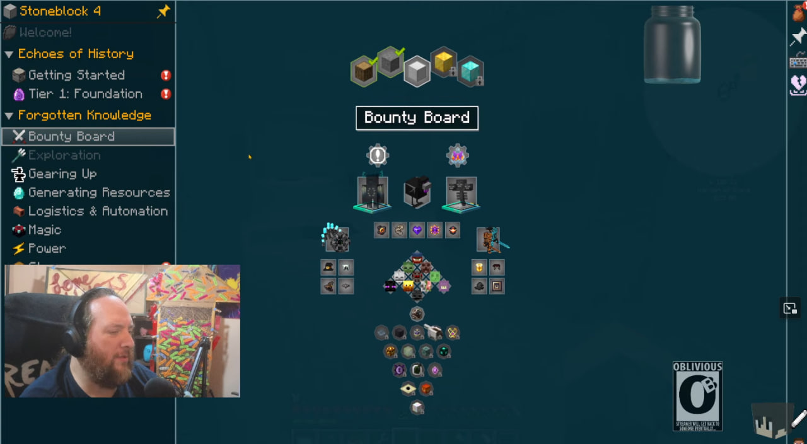
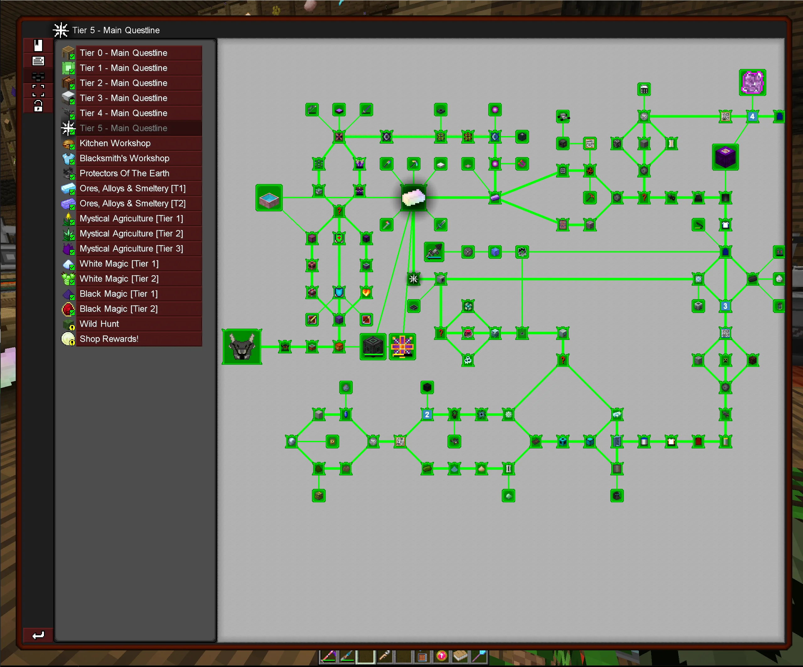
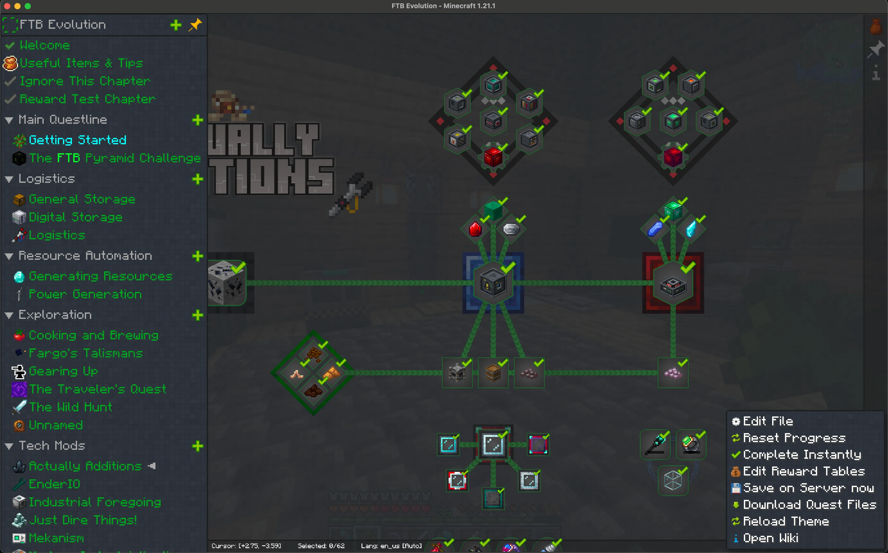

# Jugcraft TODO list

## Selected technology completion queue — 14 October 2026

**Latest owner instruction: do not test or push yet, even after packages 1–7 are
implemented.** Builds, automated checks, playtesting and publishing await explicit
owner authorization. Resource generation and source editing may continue.
Keep this work local and unmerged while validation is deferred; old green CI does
not validate these changes. The owner will control their own local playtest.

| Package | Implementation status | Remaining work |
|---|---|---|
| 1. Advanced ceramics and precision components | Implemented locally, **unbuilt / untested** | Deferred verification; see [feature record](features/advanced-ceramics-and-precision.md) |
| 2. Stainless steel and structural alloys | Implemented locally, **unbuilt / untested** | Deferred verification; see [feature record](features/stainless-steel-and-structural-alloys.md) |
| 3. Batteries and power management | Implemented locally, **unbuilt / untested** | Deferred verification; see [feature record](features/batteries-and-power-management.md) |
| 4. Advanced electronics and automation | Implemented locally, **unbuilt / untested** | Deferred verification; see [feature record](features/advanced-electronics-and-automation.md) |
| 5. Phosphate processing and fertilizers | Implemented locally, **unbuilt / untested** | Deferred verification; see [feature record](features/phosphate-processing-and-fertilizers.md) |
| 6. Synthetic fuels and recovery | Implemented locally, **unbuilt / untested** | Deferred verification; see [feature record](features/synthetic-fuels-and-recovery.md) |
| 7. Cryogenics and rocket fuels | Implemented locally, **unbuilt / untested** | Deferred verification; see [feature record](features/cryogenics-and-rocket-fuels.md) |

- [x] Package 1: reuse Pulverizer, Conditioner, Metal Press and Industrial Oven; add
  one shared Precision Finisher for ceramics, shafts and lenses, with working-head
  animation, real connection points, recipe previews and persistent locks through
  the existing machinery systems.
- [x] Add reachable porcelain/alumina/zirconia routes, reusable finishing heads,
  finished components and immediate motor/upgrade/cable/optics/polymer-tool consumers.
  Preserve old recipes, machine IDs, inventories and port layouts.
- [x] Add the Ceramics and Precision Handbook/Encyclopedia chapter and component art.
- [x] Package 2: regional chromite, concentrate and ferrochromium feed stainless
  steel; existing aluminum and magnesium feed structural alloy. Reuse the Mineral
  Conditioner, Arc Furnace, Alloy Smelter, Metal Press and Precision Finisher.
- [x] Add stainless fittings, ceramic-lined vessels, finished valves, lightweight
  frames and panels with alternate chemical equipment, pipe/tank, rocket casing,
  Zeppelin and Howitzer recipes. Preserve all original construction routes.
- [x] Add alloy material/storage forms, component art and the Stainless and
  Structural Alloys Handbook/Encyclopedia chapter. Implementation only; no tests run.
- [x] Package 3: lead-acid buffering; spodumene/LiPF6/formulated-electrolyte/LFP cells;
  mineral vanadyl-sulfate electrolyte; bounded paired flow tank modules and a separate
  cell-stack rate upgrade. Reuse existing processors and preserve old battery recipes.
- [x] Add local battery modes, charge priority, output limits and minimum-charge
  reserves, shared transactional tick budgets, module status and battery guide pages.
  Local implementation only; compatibility and playability remain unverified.
- [x] Package 4: high-purity silicon, shared crystal pulling/slicing/polishing,
  sulfuric/peroxide cleaning, Novolac-DNQ resist, TMAH development and HF etching.
  One new Wet-processing Bench; reuse Conditioner, Bulk/compact Reactors,
  Electrolytic Separator, Arc Furnace, Precision Finisher, Lithography and Assembler.
- [x] Add reusable pattern tooling, advanced chips and useful speed/efficiency/card
  assemblies. Existing circuits, recipes, machine slots and ports stay compatible;
  Lithography appends one retained pattern slot. Compatibility is still unverified.
- [x] Add server-authoritative local recipe priorities and stock targets to formed
  machines, eight saved rules, card gating, reset and in-flight output accounting.
  Add icons, connected bench geometry/animation and Handbook/Encyclopedia pages.
- [ ] Package 4 follow-up after 1–7: old lithography saves, tool/slot isolation,
  blocked reagent/waste handling, multi-lane targets, priority/lock interaction,
  card removal/reload, two-player controls and UI/visual playtest. Remote warehouse
  controls and silane/deposition remain later; spent-wafer water recovery is locally implemented in 6.
- [x] Package 5: phosphate grinding, dissolution, slurry filtration and industrial
  phosphoric acid; reuse Pulverizer, Dissolution Chamber, Filter Press, Conditioner,
  Bulk/compact Reactors and Industrial Oven. No new machines.
- [x] Add crop-group nitrogen and triple-superphosphate fertilizers, mixed-farm blend,
  compost/digestate carriers, typed sprinkler loads and existing hydroponic nutrient
  and battery precursor consumers. Preserve ordinary fertilizer and compost routes.
- [x] Add paid gypsum-residue preparation, plaster/plasterboard with slabs/stairs,
  native icons and Handbook/Encyclopedia integration. Implementation only, unverified.
- [ ] Package 5 follow-up after 1–7: tag membership and farm balance, tall-crop
  deduplication, protection boundaries, typed/legacy sprinkler saves, hopper and
  companion insertion, unload/drop duplication, blocked outputs and gypsum recovery.
- [x] Package 6: separate primary cobaltite ore, survey discovery, shared mineral
  preparation and reusable cobalt/ceramic catalyst; clean CO/H2 synthesis and
  optional gas balancing in the existing Chemical Infuser. No new machines.
- [x] Refine Synthetic Crude through the existing tower into standard fuel fractions;
  retain existing finishing, vehicle/generator fuel IDs and upstream cleaning routes.
- [x] Treat wafer mixture, recover process water and stabilize its concentrate using
  Conditioner/Distillation Station; explicit clay/lye/calcite inputs and construction
  consumer. Add native resources, owner cobalt art and Handbook/Encyclopedia pages.
- [ ] Package 6 follow-up after 1–7: cobalt terrain/startup, tool retention, output
  backpressure and Infuser water drain, refinery balances, waste recovery specificity,
  complete upgraded energy/material economy, saves and owner-led visual playtest.
- [x] Package 7: reuse the Cryogenic Liquefier with retained methane and advanced
  hydrogen cooling modules; keep the original untooled LOX recipe. Reuse the
  Distillation Station for powered, volume-matched gas recovery. No new processors.
- [x] Add shared 32/64-bucket insulated tank variants with centered connectors and
  retained fluid drops; preserve existing tanks and avoid boil-off maintenance.
- [x] Add hydrazine/N2O4 through the Bulk Reactor, residue recovery through the
  Conditioner, sealed propellant ingredients through the compact Reactor, and four
  loaded motor assemblies through the Rocket Workshop. Extend existing survey,
  weather, delivery and line payload recipes while preserving ordinary motors.
- [x] Add native item art, silver/olive tank models and Cryogenics and Rocket Fuels
  Handbook/Encyclopedia guidance. All seven packages remain local and unverified.
- [ ] Package 7 follow-up when authorized: old liquefier saves, tool insertion/removal
  and hopper isolation, tier gating, energy/volume round trips, blocked outputs,
  mixed-capacity tank groups, break/place/save preservation, motor substitutions,
  incorrect propellant pairs, recipe-view/tool previews and owner-led visual review.
- [ ] After explicit owner authorization: compilation, full data/icon audits, server/client regression
  suites, survival progression, material/energy balances, save/restart compatibility,
  recipe locks, blocked-output handling and representative factory performance.
- [ ] Owner-led local review followed by two-player manual verification before release.
- [ ] Reconcile current upstream tech PRs before their related package: #363 aluminum
  construction, #366 machine screens, and drafts #361/#364/#365/#362 for combined-cycle
  power, bulk fermentation, large bio generation and ruthenium tooling. This entry
  records the October 14 snapshot, not an assertion that those PRs are merge-ready.

## Howitzer-Walker (owner request, 13 October 2026)

- [x] **Howitzer-Walker implemented and owner playtested.** Main includes its model/animation integration, crafting, fuel/ammunition, movement, aiming, shelling, jump/stomp and server-authoritative controls. PR #356 adds continuous mouse aiming and hides the pilot model while driving. See [Howitzer-Walker](features/howitzer-walker.md). Two-player manual verification remains open.

## MUST: consolidated machine recipe interface

Owner requirement, 13 October 2026, for the Concentrator, Gas Scrubber, Filter Press and Industrial Oven, then other multi-recipe machinery. See [consolidation and compatibility](features/machine-consolidation-playtest.md). Implemented in the [recipe interface](features/machine-recipe-interface-playtest.md) and included in the owner-authorized [factory integration](features/owner-machine-integration.md). Automatic mode remains available; choosing a row only previews it until Lock recipe is clicked.

- [x] **MUST provide a searchable recipe/product picker** so players can choose what to make before inserting materials; show supported recipes and any unmet upgrade requirements.
- [x] **MUST preview exact inputs, retained catalysts/tools, outputs, byproducts, time and power**, including which tank/hatch receives each output.
- [x] **MUST implement a persistent, server-authoritative recipe lock for automation.** A locked machine may only start the selected recipe; it must not silently switch when other inputs arrive. Save/reload and multiplayer must preserve this selection.
- [x] **MUST explain why work cannot start**: missing ingredients, incompatible leftovers, missing upgrade, full/wrong output, power or pause. Never delete tank contents or consumed batch inputs when changing selection.
- [x] **MUST preserve running batches when selection changes** and apply a new selection only to subsequent work; validate permissions, recipe eligibility and all client requests on the server.
- [ ] **MUST complete a two-player manual server playtest** of selection, lock, automation and reload before release. Automated server tests cover selection, persistence, input/output blocking and shared viewer state; the native client test covers controls and readable layouts. Automatic remains an explicit selectable mode.

Local consolidation checkpoint: four recommended machines share the former nine specialists' processes. Old block IDs and construction recipes remain supported. Included in the owner-authorized factory integration; combined human multiplayer verification remains open.

Local October 13 checkpoint: [fluorochemistry and PTFE](features/fluorochemistry-playtest.md) uses main's regional fluorite deposits and adds concentrated acid, HF, named fluorocarbon intermediates, PTFE powder/shaping/sintering, useful seals/fittings/liners and a larger two-lane reactor. It extends the [ordinary polymer factory](features/polymer-factory-playtest.md). Included in the owner-authorized factory integration.

Merged in PR #358: [coastal magnesium, staged titanium and Polymer Molding Press](features/coastal-metals-and-polymer-playtest.md). The shared factory integration preserves the eight station IDs, six reusable molds and current product consumers; later consolidation reduces the recommended station set. Broader alloys and bulk plants remain follow-ups.

**Merged in PR #358:** [Expanded fermentation and first aluminum refinery](features/biorefinery-and-aluminum-playtest.md), including connected ethanol/stillage processing and staged bauxite/lye recovery to existing aluminum products. Larger variants, demanding fuel dehydration, alloys and further specialized aluminum consumers remain follow-ups.

This list tracks concrete owner-requested follow-ups. Checkboxes distinguish implementation from validation where explicitly stated; an unchecked compound task may have implemented subparts described alongside it. Local implementation is not a main merge or a passing test. See the [roadmap](ROADMAP.md) for the wider delivery direction and [existing-content map](WHAT_EXISTS.md) for current source. Feature details and dependencies belong in their linked briefs.

See the [organized implementation and next-work index](INTEGRATION_STATUS.md) for the current integration and priorities.

## Ars Goetia summoning and pacts

- [ ] Implement a shared summoning and pact system for all 72 Ars Goetia spirits, including Stolas.
- [ ] Begin with Stolas connected to Styx, botany, astronomy and minerals; expand through shared definitions and server-authoritative costs, permissions and persistence.

This is future gameplay, as recorded in the [roadmap](ROADMAP.md#owner-requested-todo-ars-goetia-summoning-and-pacts).

## Jugcraft Encyclopedia

Local implementation, 12 October: [acid factory and first Encyclopedia](features/acid-factory-and-encyclopedia.md) adds inventory/K access, searchable canonical guides, suggested route diagrams and personal advancement-backed goals. Await local review; the broader polish/editorial checklist below is not all complete.

Owner-requested 6 October 2026. Independent feature brief: [Jugcraft Encyclopedia](features/jugcraft-encyclopedia.md). All ten supplied screenshots are included in the [reference gallery](#reference-gallery) below and archived in the [reference folder](images/jugcraft-encyclopedia/README.md).

- [ ] **Build the full Jugcraft Encyclopedia UI**, covering technology, magic, detailed pathways and integrated quests.
- [x] Add an inventory entry button and a configurable keybind. Both open the same Encyclopedia without crafting, carrying or using an Encyclopedia item. (Concordance Chunk A's first slice; its client test passed in CI run 38435014953; not yet merged; [record](features/arcane-concordance-first-route.md).)
- [ ] Provide a home view explaining the overall machinery/technology route and the overall magic route.
- [ ] Add chapter/specialty navigation and in-depth pages for each pathway within both routes, including useful products, entry requirements, process steps and optional branches.
- [ ] Explain the essential technology path and the substantial pre-electric workshop's sideways possibilities. Show steel and electricity as parallel capabilities under the owner's planning direction.
- [ ] Cover technology specialties such as ceramics/construction, mechanical power, metals, electricity, logistics, industrial agriculture, mineral separation, chemical refining, recovery/pollution and later precision/expedition systems as those features become available.
- [ ] Give magic its own overview and detailed school/ritual/spell/apparatus/reagent pathways, with useful crafting, cultivation, exploration and combat applications.
- [ ] Design route graphs with readable connections, grouped nodes and prominent milestones. Distinguish actual required materials/capabilities from recommendations, trade alternatives and suggested quest order.
- [ ] Provide detailed machine/material/spell/ritual entries and recipe/process links using canonical game data; clearly label planned versus implemented content.
- [ ] Include quests linked to their pathway explanations, with objectives and visible progress/completion. Keep the guide useful without requiring every player to complete every branch.
- [ ] Decide quest objective types, detection/consumption rules, reward policy, spoiler rules and individual/shared-party progress before implementing those behaviors.
- [ ] Implement authoritative quest completion and any approved rewards with stable identifiers, persistence and duplicate-claim prevention.
- [ ] Design search, navigation/history, accessibility and readable states across supported GUI scales; consider optional bookmarks and pinned goals.
- [ ] Decide compatibility for the existing Engineer's Handbook while preserving saved registrations. The new Encyclopedia itself is not an item.
- [ ] Build an original Jugcraft visual presentation informed by the ten references, without importing their depicted artwork or requiring an external quest mod by assumption.
- [ ] Verify both entry points, route/content accuracy, GUI behavior, bounded performance, and relevant two-client/restart/reconnect/quest persistence behavior.

A [first-slice prototype](features/jugcraft-encyclopedia.md#first-slice-entry-points-and-route-home) of the entry points and the home's two routes is proposed in a community draft PR. These boxes stay open until the owner accepts it and it is verified in game. Exact visuals, the final default key, quests/rewards and release order remain to design. The feature is broader than the industrial plan: it must independently explain magic and the deeper pathways in both routes.

## Progression and balance

- [ ] Tune the minimum fresh-world route to first electricity toward **2–4 active hours when following known recipes**, excluding optional building detours. This is an approximate playtest target, not a timed gate or a measured result.
- [ ] Map the reachable essential ceramics/mechanical workshop/electrical component route and its bootstrap requirements, with parallel steel progression.
- [ ] Place substantial construction, agricultural, mineral and recovery choices beside the essential route; do not require completing every specialty before moving to another capability.
- [ ] Validate the route in representative solo and trade scenarios, then adjust material quantities, processing time and power costs from actual playtest evidence.

Related owner planning records: [industrial agriculture, PR #208](https://github.com/jimbozoomer-byte/jugcraft/pull/208), [mineral sands/refining, PR #209](https://github.com/jimbozoomer-byte/jugcraft/pull/209), and [waste/recycling/pollution, PR #210](https://github.com/jimbozoomer-byte/jugcraft/pull/210). These are planning work, not claims that those proposed systems are implemented.

## Industrial machine models textures and dimensions

Owner-requested 10 October 2026. Independent art specification: [industrial machine models, textures and dimensions](features/industrial-machine-models-and-textures.md). It covers 79 unbuilt machine/module forms and later candidates, with 23 additional larger variants. All sizes are **width × depth × height**, each axis 2–6 blocks; several installations are 6×6×6.

- [x] Describe silhouettes, modeled mechanisms, textures/palettes, interfaces and bounded motion for the unbuilt industrial forms across the connected plans. Distinguish existing foundations, future forms and optional later candidates.
- [ ] Turn the briefs into detailed models and textures in focused implementation work, preserving the familiar family appearance in larger variants and the specified 2–6-block envelopes.
- [ ] Reuse or recolour suitable owner-library art with exact source/transform provenance and preserved animation metadata. Finish backs, undersides, interior surfaces and UVs.
- [ ] Define actual multiblock occupancy, entry parts, placement/formation and moving-group bounds alongside independently reachable construction recipes. Keep shared processing roles rather than compulsory duplicate machines for every product.
- [x] Build the shared form foundation, package 1 of the [factory implementation plan (PR #302)](https://github.com/jimbozoomer-byte/jugcraft/pull/302): validated 2–6-block envelopes with structure/clearance/access positions, placement that names obstructions, port-only transfers, protected tool sockets, eight-state status, durable batch escrow with reserved outputs, entry/expanded/bulk lanes and legacy tank-layout migration. See [industrial machine foundation](features/industrial-machine-foundation.md); tested on test-mod forms only.
- [x] Package 2, first slice: the Electrolytic Separator, the first real form, with its sliced model from the art brief, the selected 20-plate construction, capability recipes for water and brine at the selected baseline, and lye kept with brine stopping when full. See [Electrolytic Separator](features/industrial-electrolytic-separator.md).
- [x] Package 2, second slice: the Gas Burning Generator, the shared hydrogen/methane generator and the first generator form, burning hydrogen at the selected 128 JE/t from the plan's steel bill, with its turning coupling and fan. Generator forms join the foundation: fuels listed on the form and power-out ports. See [Gas Burning Generator](features/industrial-gas-burning-generator.md).
- [x] Package 2, third slice: the Chemical Infuser, the shared gas-reaction form, with its sliced model and turning fan from the art brief, the plan's starter bill, its water drain and hydrogen chloride from hydrogen and chlorine at the plan's 9,600 JE a batch. See [Chemical Infuser](features/industrial-chemical-infuser.md).
- [x] Package 2, methane power: carbon dioxide from coal in the Oxidizer, CO2 methanation over the Nickel Catalyst Bed in the Infuser with its water drain, and methane as the Gas Burning Generator's second fuel at 256 JE/t. See [methane power](features/industrial-methane-power.md).
- [ ] Package 2, the rest of the starter gas and acid factory:
  - hydrogen chloride absorption into aqueous acid, and its consumers (the [Bulk Chemical Reactor](features/industrial-bulk-chemical-reactor.md) now makes hydrochloric acid and leaches ores with it; later consumers remain);
  - contact conversion and absorption, for the sulfuric acid chain (implemented in [contact sulfuric acid](features/industrial-contact-sulfuric-acid.md), with the vanadium contact bed; the retained carrier-acid charge remains);
  - the Coal Gasifier with Gas Cleanup and Separation (implemented in [coal gasification](features/industrial-coal-gasification.md); its mixed residue and road/filler use are in [gasification residue](features/industrial-gasification-residue.md); numeric pollution remains);
  - portable handling.

  Local owner-playtest branch, 12 October: [starter chemistry slice](features/starter-chemistry-playtest.md) implements the four entry forms, gas recipes, permanent catalyst beds, recovered-water control, methane generation and a mixed-residue construction route. Existing portable gas cylinders handle the new gases. Await the owner's local visual/gameplay review before merging. The [acid factory follow-up](features/acid-factory-and-encyclopedia.md) now implements wet absorption in the Chemical Reactor and its retained acid carrier locally. Broader pollution integration and larger variants remain open; owner acceptance is still pending.

  Enforce the electrolysis energy floor before any expanded or bulk Separator.
- [ ] Inspect every completed form from all sides in-game, including idle/running states, module arrangements and lighting; verify bounds, placement and persistence. The current brief provides descriptions only.

## Industrial factory implementation planning

Owner-requested autonomous planning pass, 10 October 2026. [Delivery blueprint](features/industrial-factory-implementation-plan.md), [construction and operation](features/industrial-machine-construction-and-operation.md), and [production lines and layouts](features/industrial-production-lines-and-factory-layouts.md). New numeric defaults and layout choices are proposals; earlier owner selections remain authoritative.

- [x] Prepare a substantial connected plan with nine delivery packages, entry/expanded/bulk operating profiles, shared machine construction patterns, protected tooling/atomic work, 36 production routes and eight sample factories with 71 machine placements.
- [ ] Review the proposed package order, profile savings/buffer sizes, large-plant construction investment and one-pair reference flow-bank arrangement with the owner.
- [ ] Implement the shared form/port/tool/work foundation and legacy mappings before expanding incompatible machine layouts. Preserve the six-process-tank limit unless a separate reviewed schema change is needed.
- [ ] Complete explicit mineral/solution/fuel/precursor ledgers and independently reachable construction receipts, then deliver the starter gas/acid slice with rollback/restart/upgrade checks.
- [ ] Continue the selected useful metals/fertilizers/polymers, agricultural manufacture, large fuels, precision chips, grid storage and cryogenic consumer packages through focused tested changes. Integrate recovery, pollution measurement and Encyclopedia guidance alongside relevant packages.
- [ ] Build and measure the proposed small/medium/stress factory fixtures; validate art, transfers, persistent work/storage and all supported module combinations. Layout and arithmetic checks are documentation checks, not gameplay evidence.

## Industrial chemistry, gas fuels and advanced materials

Owner-requested 7 October 2026. Independent briefs: [industrial chemistry and fuels](features/industrial-chemistry-and-fuels-plan.md) and the [complete chemical, machine and consumer catalog](features/industrial-chemical-catalog-and-routes.md). These follow-ups are planning work, not implemented recipes or tested balance.

- [ ] Map a reachable **steel-built electrical chemistry entry**, preserving the earlier workshop/first-electricity route and prioritizing gas processing, aluminum and titanium.
- [x] Record all ten owner-selected A choices in the [eighth starter-factory batch](features/industrial-starter-gas-and-acid-factory.md#recorded-starter-factory-choices-eighth-batch): forms, Separator/nickel costs, automatic heat, full first acid chain, water/lye overflow, one residue and provisional processing/generation rates. This completes planning choices, not gameplay implementation.
- [x] Record all eight A selections in the [ninth catalyst/coal batch](features/industrial-starter-gas-and-acid-factory.md#recorded-acid-catalyst-and-coal-processing-choices-ninth-batch): independent mineral catalyst supply, recirculating initial acid, shared contact conversion, sulfur/carbon feeds, optional oxygen assistance, combined cleanup and useful stabilized residue. Planning only.
- [ ] Specify the selected starter catalyst/mineral preparation and absorber carrier accounting, coal carbon/heat/yields, residue binder/processing, and remaining construction/unit/energy limits before gameplay implementation.
- [x] Record all ten A selections in the [tenth metals-processing batch](features/industrial-chemistry-and-fuels-plan.md#magnesium-aluminum-and-titanium-processing-decisions-tenth-batch), including seawater pumping from **beach or ocean biomes**, concentration, staged dry chloride feed, titanium salt recovery/cleanup, aluminum carbon/lye handling, shared purification, whole-ingot alloys and stabilized bauxite filler. Planning only.
- [ ] Specify exact beach/ocean source IDs/tags and intake validation; magnesium hydroxide/HCl preparation, drying and electrolysis receipts; titanium salt conditioning/recovery and cleanup; lye makeup; carbon/CO2 quantities; alloy ratios; and bauxite binder/yields. Audit independent startup, material conservation and complete energy costs before implementation.
- [x] Record all eight A selections in the [eleventh polymer/electronics batch](features/industrial-chemistry-and-fuels-plan.md#polymer-and-advanced-electronics-decisions-eleventh-batch): later renewable ethylene, compatible ordinary PE/PVC products, clean same-grade offcut recycling, distinct high-purity silicon, shared precision cutting, reusable pattern plates, function-related module parts and one initial spent mixture. Planning only.
- [ ] Specify renewable ethylene feed/byproduct/energy receipts, product compatibility tags, conserved product/offcut allocation and recycling losses; high-purity silicon preparation, cutting and pattern-tooling entry; module bills/caps; and spent-mixture composition/output handling and future recovery. Preserve independent startup and current consumer routes.
- [x] Record all ten A selections in the [twelfth storage/fuel/cryogenic batch](features/industrial-chemistry-and-fuels-plan.md#grid-storage-synthetic-fuels-and-cryogenics-decisions-twelfth-batch): steel-era lead-acid, staged lithium electrolyte, mineral vanadium, attached paired flow modules, local priorities/reserves, reusable cobalt tooling, synthetic-crude refining, methane before hydrogen cooling, shared insulated tanks and hydrazine first. Planning only.
- [x] Implement cryogenic tiers/conversions, shared insulated tanks and hydrazine/oxidizer/motor recipes locally in [package 7](features/cryogenics-and-rocket-fuels.md). Cobalt supply/tooling and synthetic-crude refining are local in [package 6](features/synthetic-fuels-and-recovery.md); battery preparation/control is in [package 3](features/batteries-and-power-management.md). Full energy/material and compatibility validation remains deferred; this is not a tested-complete claim.
- [x] Record **A, A, B, A, A, A, A, A** in the [thirteenth resource/reagent/residue batch](features/industrial-chemistry-and-fuels-plan.md#resource-reagent-and-residue-decisions-thirteenth-batch): galena, spodumene first, **separate primary cobalt ore (3 B)**, chromite concentrate, vanadium-bearing iron concentrates, electrochemical peroxide, novolac/DNQ and prepared gypsum-rich residue ingredients. Planning only.
- [ ] Finish still-unnamed source identities, regional discovery and independent cobalt preparation. Packages 2–3 locally add chromite refining, galena concentration using existing raw lead, spodumene refining and mineral-derived electrolyte alongside the existing non-sulfuric vanadium entry. Preserve feed/stock IDs and audit producer costs; ordinary iron/nickel is not a free coproduct source.
  - Spodumene deposits implemented for owner world inspection: [PR #351](https://github.com/jimbozoomer-byte/jugcraft/pull/351), branch `speedygroyper:codex/spodumene-deposits`; [scope, tests and combined mineral preview](features/spodumene-deposits.md). Expanded lithium refining remains separate.
- [x] Locally implement powered oxygen/water peroxide and novolac/DNQ/developer stages in package 4; paid fictional gypsum-rich residue preparation and finished plaster/board ingredients in [package 5](features/phosphate-processing-and-fertilizers.md). Explicit game receipts are authored; material/energy balance and compatibility verification remain deferred. No real manufacturing/cleanup procedure is selected.
- [x] Consolidate the selected routes into a [connected production map and proposed implementation work packages](features/industrial-chemistry-and-fuels-plan.md#delivery-and-remaining-decisions). Work-package grouping is an assistant proposal; gameplay implementation and exact recipe/statistics specification remain unchecked.
- [ ] Deliver the selected **first starter gas/acid factory milestone**: water/brine electrolysis, CO/H2 preparation, synthesis, HCl/sulfuric supply, portable tanks/shared pipes and usable H2/methane generation. Use the [first-factory map](features/industrial-chemistry-and-fuels-plan.md#first-delivery-milestone-starter-gas-and-acid-factory); specify reachable construction/first acid catalyst and complete budgets before gameplay. Magnesium/aluminum/titanium and alloy expansion follows.
- [ ] Build the selected shared hydrogen/methane gas-burning generator role and separate lower-output **Bio-Generator for cleaned biogas and bioethanol**; methane improves electricity per tank and upgraded gas-generator output. Audit complete processing/generation energy to prevent closed positive-power loops. The [Bio Generator](features/industrial-bio-generator.md) now burns bioethanol at 96 JE/t; cleaned biogas waits for the Digester. It also burns the [Anaerobic Digester](features/industrial-anaerobic-digester.md)'s biogas at 64 JE/t ([biogas power](features/industrial-biogas-power.md)).
- [ ] Define distinct CO2 + 4 H2 and CO + 3 H2 methanation recipes, the reusable first catalyst bed from existing nickel/ceramic supplies, optional later ruthenium improvement, readable heat requirements and recovered water. The CO2 recipe, the Nickel Catalyst Bed and the water drain are implemented ([methane power](features/industrial-methane-power.md)), and the CO + 3 H2 recipe ([coal gasification](features/industrial-coal-gasification.md)); ruthenium and heat requirements remain.
- [ ] Keep gas-pipe pressurization automatic, with no player-managed compressor machines/modules, pressure tiers/settings or per-pipe pressure simulation.
- [ ] Add the earlier steel-era coal gasifier's CO/hydrogen mixture, cleanup and separation into useful gases, with substantial numeric pollution; keep CO separate from digester CO2. The Gasifier, the cleanup rack and CO methanation are implemented ([coal gasification](features/industrial-coal-gasification.md)); numeric pollution waits for a pollution system.
- [ ] Design the substantial first bulk Anaerobic Digester, with larger versions later, using the selected 60/40 methane/CO2 game mixture, usable digestate, direct cleaned-biogas Bio-Generator use and optional hydrogen upgrading into separated methane. The [Anaerobic Digester](features/industrial-anaerobic-digester.md) and the Infuser's biogas upgrading are implemented; Bio-Generator biogas burning, cleanup and larger versions remain.
- [ ] Develop the earlier milling/mashing -> fermentation -> distillation Bio-Generator fuel route, adding dehydration for later demanding fuel/blending uses and brewery CO2 collection/cleanup; preserve existing bioethanol IDs and consumers. The [Industrial Fermenter](features/industrial-fermenter.md) now ferments crops into bioethanol and collects the CO2, venting what is not collected; milling/mashing, distillation, dehydration and the 5×5×6 variant remain.
- [ ] Add optional CO2 capture/release to industrial carbonate cement processing and optional Coke Oven gas/condensate recovery. Full CO2 capture storage defaults to continued production/excess venting, with optional stop-instead; account for material, energy and recovered/released amounts once. The stop-instead setting is built: every form with a vented tank now has an "Excess: vent / hold" switch on its screen ([vent or hold](features/industrial-vent-or-hold.md)).
- [ ] Add the earlier steel-era coal gasifier's CO/hydrogen mixture, cleanup and separation into useful gases, with substantial numeric pollution; keep CO separate from digester CO2.
- [ ] Design the substantial first bulk Anaerobic Digester, with larger versions later, using the selected 60/40 methane/CO2 game mixture, usable digestate, direct cleaned-biogas Bio-Generator use and optional hydrogen upgrading into separated methane.
  - Local implementation: [digester factory playtest](features/anaerobic-digester-playtest.md) includes the 6×6×6 digester, biogas cleaner, digestate separator, Bio-Generator, usable fertilizer residue and optional Infuser methane upgrading. The owner tested the local factory previews and authorized integration. The expanded fermentation/biofuel routes are also included; larger variants remain open.
- [ ] Develop the earlier milling/mashing -> fermentation -> distillation Bio-Generator fuel route, adding dehydration for later demanding fuel/blending uses and brewery CO2 collection/cleanup; preserve existing bioethanol IDs and consumers.
- [ ] Add optional CO2 capture/release to industrial carbonate cement processing and optional Coke Oven gas/condensate recovery. Full CO2 capture storage defaults to continued production/excess venting, with optional stop-instead; account for material, energy and recovered/released amounts once.
- [ ] Use earlier copper conductors in entry aluminum-processing equipment, with aluminum improvements later; verify construction and reagent producers without self-output gates.
- [ ] Verify filled gas tanks retain exact content through break, pickup and placement and reconnect through shared pipes; cover joined-tank partitioning, simultaneous transfers and multiplayer pickup. Server game tests (`GasTankHandlingGameTests`) now cover a gas tank's exact contents through break and place, breaking one tank of a joined group, a placed tank rejoining its group and its pipe line, two pushes into a nearly full tank in one tick, and tanks of two fluids side by side; and two mock players reaching one dropped tank in the same tick (exactly one gets it, with its exact contents); a real two-client playtest remains.
- [ ] Detail H2/chlorine -> HCl and selected refinery-derived ethylene -> ethylene dichloride -> vinyl chloride -> PVC, with appropriate HCl recovery/reuse; retain existing PVC, butadiene rubber and natural-rubber routes. The ethylene dichloride route with HCl reuse is implemented ([PVC with HCl recovery](features/industrial-pvc-hcl-recovery.md)); the existing routes are kept.
- [ ] Expand process-specific reagents, useful rigid/flexible/protective/heat-resistant polymers and advanced ceramic linings/insulators/cutting/precision parts. Limit purity grades to meaningful consumers; prioritize refining/electronics over broad new everyday finishes.
- [x] Develop titanium mineral treatment -> crude titanium chloride -> purification -> magnesium reduction -> titanium sponge -> melting using compatible shared equipment. Supply first magnesium through **seawater pumped from beach or ocean biomes -> concentration -> magnesium hydroxide/HCl chloride preparation -> dry MgCl2 item -> internally heated molten-salt electrolysis**. Reuse shared distillation, integrate paid sponge cleanup and recycle separated MgCl2 from the first titanium installation. Define source validation and account for chlorine, water/residues and shared alloy demand, with independent earlier construction and no magnesium from freshwater/pure sodium-chloride brine. Preserve existing routes until replacements work.
- [ ] Add aluminum's affordable bulk electrical/lightweight structural/panel/vehicle roles; titanium advanced process/precision equipment and vehicle components; and stronger titanium tools/armor above steel with balanced statistics.
- [x] Build the selected shared **Polymer Molding Press with reusable molds** for housings, fittings, insulation, gaskets, flexible hoses and vehicle panels; use earlier supplies for the first station/tooling.
- [x] Locally implement ceramic powders -> prepared charges -> pressed blanks -> shared Industrial Oven -> precision finishing: clay foundation, porcelain insulators, alumina plates/bearings and specialist zirconia cutting inserts. The same Finisher serves steel shafts and glass lenses; early clay/steel recipes remain reachable. See [package 1](features/advanced-ceramics-and-precision.md). **Unbuilt and untested; not merged.**
- [ ] Validate the ceramics/precision chain with packages 1–7, including real consumers, coolant accounting, locks, tooling, persistence and old-factory compatibility. Integrate a regional zircon-sand producer later without removing the existing-world starter route.
- [x] Implement **chromium/nickel stainless steel** and **aluminum-magnesium structural alloy** locally on shared equipment, with regional chromite, reachable feedstock, explicit game batch ratios and useful chemical/structural consumers. See [package 2](features/stainless-steel-and-structural-alloys.md). **Unbuilt, untested and unmerged** pending packages 1–7.
- [ ] Validate package 2's regional generation, progression, recipe balances, feature gates, shared machine UI/automation and save compatibility after packages 1–7. Add titanium alloys as a later extension; this package does not implement them.
- [ ] Begin refining with compact functional stations and optional larger bulk plants. Larger chemical machines gain **higher throughput and lower energy per unit**; upgraded small machines remain useful for smaller production lines. Balance complete process chains and retain the separately selected substantial first Anaerobic Digester.
- [x] Locally implement general storage: lead-acid, expanded LiPF6 lithium cells and modular vanadium flow storage; preserve all earlier routes. See [package 3](features/batteries-and-power-management.md). **Unbuilt, untested and unmerged.** Portable packs and specialty high-output banks stay later.
- [ ] After packages 1–7, validate all battery recipes, old saves, shared tick budgets, reserve/priority controls and module detach/unload/pickup accounting. Review lossless transfer compatibility and old/new recipe balance before release.
- [ ] Map the requested Electrolytic Separator, Chemical Infuser, Chemical Oxidizer, Chemical Dissolution Chamber and Rotary Condensator roles onto existing shared systems; preserve current IDs and automatic gas-pipe pressure. Develop **both installed upgrade chips/modules and larger advanced physical versions**, with explicit compatible capabilities and independently reachable first controls.
- [ ] Make sulfuric acid a central industrial supply with reachable sulfur oxidation/conversion/absorption and useful fertilizer/battery/mineral/petroleum consumers. Implement selected **ordinary, concentrated and electronic-grade supplies**, distinguishing concentration from purity and accounting for water/impurities/losses. Avoid first-acid catalyst dependency cycles.
- [x] Locally map electronic-grade sulfuric purification to the existing Mineral Conditioner: paid water/acid conversion with accounted spent mixture, no new pure-water currency or self-output construction gate. See [package 4](features/advanced-electronics-and-automation.md). **Unbuilt and untested.** Additional electronic-grade reagents remain later.
- [ ] Design **substantial underground fluorite deposits in snow biomes with occasional surface outcrops**, with eligible biome IDs/tags, abundance/depth, discovery and existing-world behavior explicitly reviewed. Add independently reachable fluorite CaF2 -> heated concentrated-sulfuric processing -> HF plus accounted calcium sulfate; define gas/aqueous recovery and compatible starter hardware before HF/PTFE exists.
  - Deposit/worldgen slice implemented and locally tested, including the owner's follow-up stone-outcrop improvement: [PR #343](https://github.com/jimbozoomer-byte/jugcraft/pull/343), branch `speedygroyper:codex/fluorite-deposits`; [scope, validation and inspection-world coordinates](features/fluorite-deposits.md). HF/PTFE processing remains separate.
- [x] Local implementation: **snow-biome fluorite deposits and upper exposed veins**, explicit biome tags, depth/abundance defaults, Ore Survey support and new-chunks-only placement. Independent concentrated-acid/dissolution machines supply HF gas and accounted calcium sulfate; optional powered preparation makes gypsum construction binder. See [fluorochemistry](features/fluorochemistry-playtest.md). Owner terrain/balance playtest and publication remain; aqueous/electronic-grade HF belongs to the later wafer chain.
- [x] Locally implement phosphate dissolution, slurry filtration and phosphoric-acid recovery, triple-superphosphate fertilizer and a battery precursor consumer. Add paid gypsum-rich residue washing/firing into binder and plaster/board families with explicit inputs, spent wash, time and power. See [package 5](features/phosphate-processing-and-fertilizers.md); validation remains deferred.
- [ ] Extend nitric/ammonia chemistry for ammonium-nitrate fertilizer and compatible finished game ammunition/rocketry products; review owner-requested aged pine/maple finishes separately. Ammonium nitrate is built: a three-dose fertilizer and the filling of grenades and HE rockets ([ammonium nitrate](features/industrial-ammonium-nitrate.md)).
- [x] Locally implement **named nitrogen/phosphate fertilizers, crop-group tags and mixed-farm blends**, with ammonium-nitrate/triple-superphosphate, compost and digestate inputs. Hand use and typed sprinkler loads retain optional farm specialization; ordinary compost/fertilizer remain available. See [package 5](features/phosphate-processing-and-fertilizers.md).
- [ ] After 1–7, verify fertilizer crop groups, costs, benefits and agriculture feedback loops in survival and automated farms; implementation is not balance approval.
- [ ] Connect HCl-assisted corn-starch hydrolysis to finished glucose syrup; acetic acid/vinegar to acetate monomers and PVAc adhesives/appropriate fibre applications; citrus/citric acid to preservation, sour candy and drinks; food-grade phosphoric acid to cola.
- [ ] Plan acetylsalicylic-acid medicine with independently reachable precursors and defined game effects; keep pharmacy optional to industrial progression.
- [x] Locally implement the first advanced-chip core: sulfuric/peroxide cleaning, TMAH, HF etching, Novolac-DNQ photoresist and separate wet-processing/exposure, with shared paid peroxide production and independently reachable tooling. See [package 4](features/advanced-electronics-and-automation.md). **Unbuilt and untested.** Silane/deposition remain later.
- [x] Locally assemble the general advanced chip into existing speed/efficiency upgrades and a new local Automation Card. Saved priorities/stock targets use bounded controller-only accounting and preserve locks/running batches. See [package 4](features/advanced-electronics-and-automation.md); validation is deferred. Remote/coordinated controls remain later.
- [x] Local playtest: ethylene from refinery/bioethanol, staged PVC, HDPE/LDPE pellets, the **Polymer Extruder**, reusable dies, compatible molding and clean same-grade recovery. See [polymer factory](features/polymer-factory-playtest.md); included in the owner-authorized factory integration.
- [x] Local implementation: chloroform -> chlorodifluoromethane -> TFE -> PTFE powder -> shaped blanks -> sintered **seals, fittings and liners**, used together to build the larger Lined Fluorochemical Reactor. Shared press, kettle, paste extrusion and clean offcut recovery are connected. No retrofit or replacement-upkeep requirement; first equipment remains reachable. See [fluorochemistry](features/fluorochemistry-playtest.md); included in the owner-authorized factory integration.
- [x] Locally implement primary cobaltite -> concentrate -> cobalt stock -> reusable cobalt/ceramic tooling. Connect existing coal/charcoal/Coke gasification and cleanup, CO/H2 synthesis, Synthetic Crude and shared refining/finishing into standard fuels. [Package 6](features/synthetic-fuels-and-recovery.md) also adds spent-wafer water recovery and stabilized residue. Unbuilt and untested.
- [ ] After 1–7, audit complete synthetic-fuel material/energy allocations, generator returns, recovery losses and survival economics, including speed/efficiency upgrades and heat recovery.
- [x] Locally connect methane/LOX, LH2/LOX, hydrazine monopropellant and hydrazine/N2O4 loaded motors to existing atmospheric rocket payload recipes, preserving solid and RP-1/LOX routes. Implement LOX -> methane -> advanced hydrogen cooling and shared insulated tank variants. Unbuilt/untested; see package 7.
- [ ] Later rocketry: MMH, orbital engine behavior, launches, planets/moons, station roles and servicing. Current loaded motors change manufacturing choices and batch yields, not payload range or access to destinations. Ordinary Rotary Condensator roles remain separate.
- [x] Locally extend the existing Flow Battery with VOSO4-based formulated electrolyte, four attached paired tank modules, a separate cell-stack rate upgrade, local charge priorities/modes/reserves/output limits and one controller-owned fluid/energy ledger. Existing mineral and refinery-residue supplies remain available. See [package 3](features/batteries-and-power-management.md) for bounds, costs, detach/reload behavior and the lossless compatibility decision. **Unbuilt and untested.** Global discharge arbitration and remote dispatch remain later work.
- [ ] Add boric-acid/boron connections for suitable nuclear control and advanced solar manufacturing, plus later sulfamic/sulfamate terminal plating with reviewed nickel/zinc compatibility.
- [ ] Deliver industrial fertilizers, refining and polymers before the new optional chemical drinks, preservatives, adhesives and medicine; preserve independently useful earlier agriculture, food and adhesive routes.
- [ ] Document actual machine roles, recipes, consumer links and optional paths in the Encyclopedia; audit reachability, gas/element units, energy loops, pollution, bounded factory work and persistence before gameplay delivery.

## Reference gallery

All ten original owner-attached UI screenshots are preserved unchanged. They are documentation/design references, not Jugcraft runtime textures. Descriptions and individual file links are in the [independent feature brief](features/jugcraft-encyclopedia.md#visual-references-and-provenance); provenance and integrity metadata are in [the manifest](images/jugcraft-encyclopedia/reference-manifest.json).

Show all ten Encyclopedia UI references

| Reference 01: chapter sidebar / quest board | Reference 02: completed magic route |
| --- | --- |
|  |  |

| Reference 03: resource/process dependencies | Reference 04: tier and specialty navigation |
| --- | --- |
|  |  |

| Reference 05: main and side pathways | Reference 06: thematic route columns |
| --- | --- |
|  |  |

| Reference 07: focused major-milestone route | Reference 08: technology, magic and encyclopedia |
| --- | --- |
|  |  |

| Reference 09: illustrated chapter overview | Reference 10: grouped logistics/resource routes |
| --- | --- |
|  |  |

Reference rights and exceptions to the repository's default MIT grant are recorded in the [reference README](images/jugcraft-encyclopedia/README.md) and manifest. The screenshots inform navigation, grouping, route explanations and quest states; final Jugcraft visuals remain to design.
