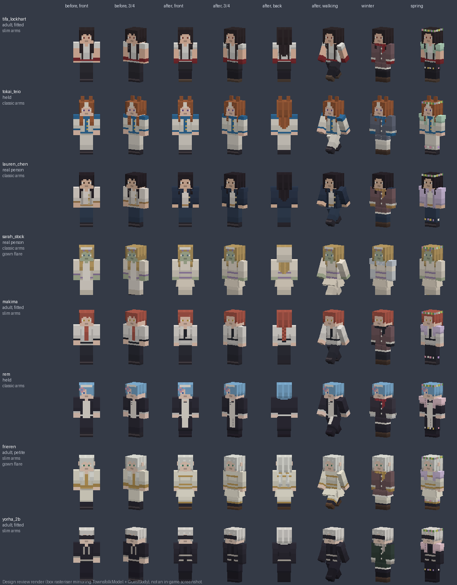
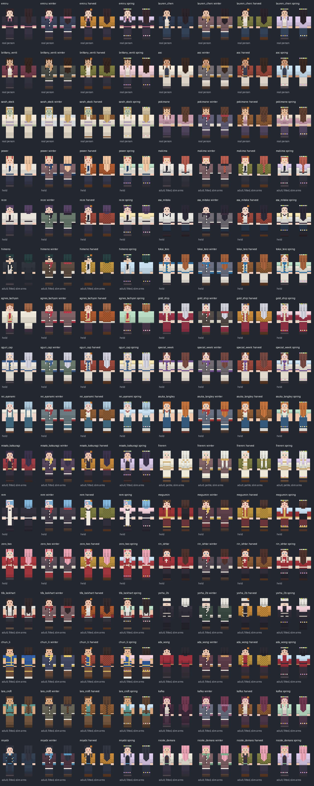

# JZE guest appearances — November 11 local implementation

The earlier filename audit found no supplied named-character skins among 48,060 asset filenames. This pass authors new Minecraft-style interpretations in the existing editable `tools/town_skins.py` UV system, through `tools/guest_skins.py`. It does not download or overwrite another creator's skin or any owner-library original.

## Implemented

32 separate 64×64 player-layout skins, each in four outfits (128 files); opaque base faces, transparent hair/clothing layers, restrained palettes and single-row eyes. The existing town humanoid provides movement. Small closed model accessories add Uma/Miyabi ears, Power/Zero Two horns, Frieren ears and Megumin's stepped hat. These are stylized interpretations, not exact portraits or owner-approved final likenesses. Real-person clothing is a representative everyday outfit, not a claim about that person's identity, beliefs or endorsement. Sarah's nongraphic zombie bridal variant is the owner's requested fictional costume and stays non-gory in every outfit.

## Body and proportion rule (owner, binding, 11 November 2026)

Romance is only for guests who are unambiguously adults; the same rule governs body shape. The generator records it as four groups (`HELD`, `REAL`, `FITTED`, `PETITE` in `tools/guest_skins.py`), and `scripts/tests/test_guest_skin_assets.py` checks them against the roster, `client/GuestBody.java` and the packaged files.

- **Held (14): asa_mitaka, tokai_teio, agnes_tachyon, gold_ship, oguri_cap, special_week, rei_ayanami, asuka_langley, rem, megumin, rin_ishtar, and power, reze, zero_two (age uncertain).** Characters shown as minors or school students, or whose age is uncertain: age-appropriate, straight proportions, classic 4-pixel arms, no curves, no shaping and no sexualised anatomy in skins or geometry; no flare panels; no aged-up or "adult alternate" versions; their seasonal outfits are the same age-appropriate coats, cardigans and flowers. Clothing and hair only (school skirts end at the knee with socks or tights below).
- **Real people (6): emiru, lauren_chen, brittany_venti, aoc, sarah_stock, pokimane.** Respectful, non-exaggerated likenesses: clothing and hair only, classic arms, no body emphasis. Sarah Stock's gown flare is clothing.
- **Adult fictional, fitted (11): makima, himeno, misato_katsuragi, tifa_lockhart, yorha_2b, chun_li, ada_wong, lara_croft, kafka, miyabi, nicole_demara.** Slim 3-pixel arms and modest shaping only: a rounded shoulder seam and a slightly darker, tapered waist seam on the outer torso columns.
- **Adult fictional, petite (1): frieren.** Slim arms only, no tailoring.

Nothing is drawn on the chest or hips for anyone. Player-like proportions, the existing UVs, closed geometry and the walking poses are kept; no model part changes size.

## What changed in this pass (worker A, Claude Opus 5.5)

Before: classic arms for everyone, a single hat-layer hair block with long hair as four straight strips on the jacket, outfits as front details over a uniform torso, trousers for everyone except two gowns. After:

- **Layered hair**: a darker under layer with slanted strands on the head; lighter strands, an uneven fringe and face-framing locks on the hat layer, each layer a row shorter than the one beneath; long hair tapering down the jacket layer's back with locks over the shoulders; curls with an uneven edge; Makima's and Lara's braids; Frieren's two tails; a bob's inward curl and nape.
- **Clothing silhouettes on the outer layers**: open blazers and jackets with V lapels (Lauren Chen, Brittany Venti, AOC, Himeno, Misato, Nicole), long coats with tails on the trouser layer (Agnes's lab coat, Kafka, Miyabi), Megumin's cape, Frieren's capelet, Rem's apron, Rei and Asuka's pinafores, collars and high necks; knee-length or shorter skirts on the trouser layer with legwear and shoes below (Asa, Rei, Asuka, Misato, Frieren, Rem, Megumin, Rin, Tifa, 2B, Chun-Li) and Sarah's full-length gown.
- **Slim arms** for the 12 adult fictional guests (the model's existing slim arms; the renderer chooses them through `GuestBody.slim`). Their skins fill the classic arm's two unused columns from their neighbours, so they still read correctly on classic arms.
- **Modest flare geometry** (`client/GuestBody.java`) for Sarah Stock's gown and Frieren's robe only: four closed panels (3×4×1 and 1×4×3 boxes) hinged at the hip, standing out 0.12 rad, sampling the skin's unused island at x 56–63, y 16–31. The front and back panels swing with the forward-most and backward-most leg every frame, relative to the body's lean, so no walking leg passes through them. Never over a player skin.

| Guest | Group | Arms | Hair | Outfit | Below the waist |
| --- | --- | --- | --- | --- | --- |
| emiru | real person | classic | long | hoodie | trousers |
| lauren_chen | real person | classic | long | navy blazer over a blouse | trousers |
| brittany_venti | real person | classic | curls | blazer over a blouse | trousers |
| aoc | real person | classic | long | light suit jacket | trousers |
| sarah_stock | real person | classic | long, veil | non-gory bridal gown | gown, flare |
| pokimane | real person | classic | curls | hoodie | trousers |
| power | held | classic | long | shirt and tie | trousers |
| makima | adult, fitted | slim | braid | shirt and tie, belt | trousers |
| reze | held | classic | bob | shirt and tie | trousers |
| asa_mitaka | held | classic | long | school shirt and ribbon | knee skirt, dark socks |
| himeno | adult, fitted | slim | bob, eyepatch | suit jacket, shirt, tie | trousers |
| tokai_teio | held | classic | long, ears | racing outfit | trousers |
| agnes_tachyon | held | classic | bob, ears | lab coat over a vest, long sleeves | trousers |
| gold_ship | held | classic | long, ears | racing outfit | trousers |
| oguri_cap | held | classic | long, ears | racing outfit | trousers |
| special_week | held | classic | long, ears | racing outfit | trousers |
| rei_ayanami | held | classic | bob | school shirt, pinafore | knee skirt, white socks |
| asuka_langley | held | classic | long | school shirt, pinafore | knee skirt, white socks |
| misato_katsuragi | adult, fitted | slim | long | red jacket over a dark dress | skirt, tights |
| frieren | adult, petite | slim | two tails, elf ears | capelet and white dress | skirt, tights, boots, flare |
| rem | held | classic | bob, clip | maid dress and apron | skirt, dark tights |
| megumin | held | classic | bob, hat | robe and cape | skirt, tights, boots |
| zero_two | held | classic | long, horns | uniform jacket | trousers |
| rin_ishtar | held | classic | long | high-necked sweater with cross | skirt, black tights |
| tifa_lockhart | adult, fitted | slim | long | top with suspenders, gloves | skirt, leggings |
| yorha_2b | adult, fitted | slim | bob, visor | dark dress, long sleeves | skirt, tall boots |
| chun_li | adult, fitted | slim | buns | qipao with gold trim | qipao skirt, tights, white boots |
| ada_wong | adult, fitted | slim | bob | high-necked top, gloves, belt | trousers |
| lara_croft | adult, fitted | slim | braid | tank top, backpack, gloves, belt | trousers, boots |
| kafka | adult, fitted | slim | long, glasses | long coat over a shirt | trousers |
| miyabi | adult, fitted | slim | long, ears | long coat | trousers |
| nicole_demara | adult, fitted | slim | long | open jacket over a dark top | trousers |

## Seasonal outfits (owner-selectable)

`town/guests/GuestWardrobe.java` holds each guest's outfit in its own saved data, `jugcraft:town_guest_wardrobe` (versioned; entries it cannot read and outfits from a newer version are kept as written). Operators choose with `/guests outfit <guest|all> <normal|winter|harvest|spring>` and read it back with `/guests outfit <guest|all>`; the `outfit` node requires permission level 2 and every command checks again on the server (the shared `/guests` root carries no requirement).

| Outfit | Texture | What it adds (same face and hair) |
| --- | --- | --- |
| normal | `guest_<id>.png` | the named skin |
| winter | `guest_<id>_winter.png` | a closed winter coat (a deep colour per guest), a scarf in the guest's accent colour, mittens, boots; Sarah: a silver stole and long gloves over the gown |
| harvest | `guest_<id>_harvest.png` | an open knitted cardigan in a harvest colour, a leaf pin, brown boots; Sarah: a knitted shawl and an amber hem band |
| spring | `guest_<id>_spring.png` | a light bolero (or a light spring jacket instead of a coat), small flowers at the hem, a flower crown |

An outfit is worn through `CustomNpcs.setTownSkin`, as the appearance migration does, only by the guest's canonical, available entity while it wears one of its own looks (its named skin, an outfit's, its placement stand-in or the exact historical stand-in). A different operator-selected town skin, another guest's skin, or a pending or resolved player skin is never overwritten; the choice waits until the guest wears its own look again. Nothing changes while any player-skin lookup is in flight, so an operator's lookup is never cancelled. "normal" restores the named skin. A guest that is not loaded changes when it next loads: once a second the wardrobe looks up chosen guests' canonical entities among loaded entities only, never loading a chunk. No relationship, ledger, affection or economy state changes.

Textures live in `src/main/resources/assets/jugcraft/textures/entity/townsfolk/`. Rebuild with `python tools/guest_skins.py`. The generator also writes `build/jze-guest-skins.png` and `build/jze-guest-outfits.png`, explicitly labelled front/back UV previews, not runtime evidence.

## Reference direction

Owner's named roster is the design brief. Character pages consulted for the series' designs include [Chainsaw Man](https://www.chainsawman.dog/movie_reze/character/), [Uma Musume](https://umamusume.jp/character), [Agnes Tachyon](https://umamusume.jp/character/agnestachyon/), [Frieren](https://frieren-anime.jp/character/), [KonoSuba](https://konosuba.com/1st/character/) and [Zenless Zone Zero](https://zenless.hoyoverse.com/en-us/character). No assets from those websites are bundled. Rin/Ishtar uses the Rin outfit for the shared identity; changing the outfit must not create a second identity. (The November 11 silhouette and outfit pass used no web research; it reworks the existing designs.)

## Remaining reference holds

Rooni, Remielle, the unnamed guest and Jakeey's K-pop picks remain unavailable until identified. An appearance/race description does not establish a person's identity. The owner has been asked for names or reference links. Detailed visual acceptance of all newly drawn skins remains a local playtest step.

## Integration

`CustomNpcs.townSkins()` accepts the packaged guest skins. Saved canonical guests wearing their exact historical development stand-in migrate on their ordinary service tick; different operator-selected town skins, named skins and pending/resolved player skins are preserved. Neither migration nor appearance assignment changes blocks or identity/affection/marriage records.

The seasonal skins, slim arms and the flare need a coordinator patch to three coordinator-owned files (worker A's report has it exactly): `CustomNpcs.townSkins()` also accepts `GuestWardrobe.skins()`; `TownsfolkRenderer` sets `state.slim = GuestBody.slim(state.skin)` for a town skin; `TownsfolkModel` adds `GuestBody.addParts(body)` to the skinnable layer, poses the flare after the legs, and shows the head accessories by `GuestBody.guest(state.skin)` so they follow a guest into its outfits. Until it is applied, the seasonal skins are refused and slim skins draw on classic arms through their filled fallback columns.

`/guests city preview` lists clear loaded lawn sites; `/guests city place` rechecks permissions and places only never-placed identities. Existing/missing canonical identities are not silently relocated or duplicated. Only creative operators in the Overworld can use city placement. It requires a three-by-three clear grass margin, avoids resident spots and nearby entities, loads no chunks and writes no blocks. Crowded or owner-edited sites are skipped; `/guests place` remains available for individually selected locations. No live city placement was performed.

## Tests

- `scripts/tests/test_guest_skin_assets.py` (run in this pass, passes): all 128 skins packaged, reproducible and unique; opaque base in slim and classic layouts; nothing outside the UV regions; the flare island only on the two flared gowns; outfits keep the face and hair; the body groups match the roster, `GuestBody` and `GuestWardrobe`; shaping appears in exactly the FITTED skins.
- `GuestWardrobeGameTests` (server) and `GuestWardrobeClientGameTests` (client, screenshots `guest_wardrobe_*`): written, not run in this pass; Codex runs them after the patch.

Tool attribution: OpenAI Codex, code-authored pixel assets and local Java integration (first pass). Claude Opus 5.5 (worker A, November 11): the silhouette, body-rule and seasonal-outfit pass, GuestBody and GuestWardrobe.

