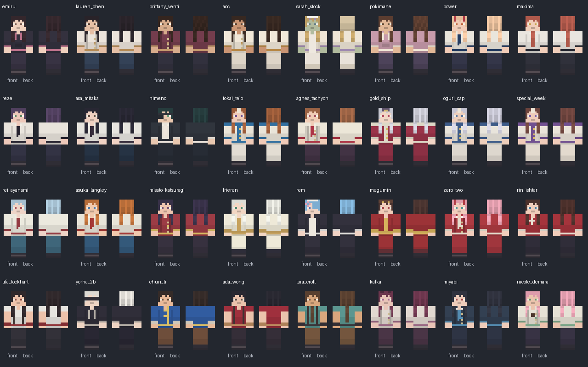
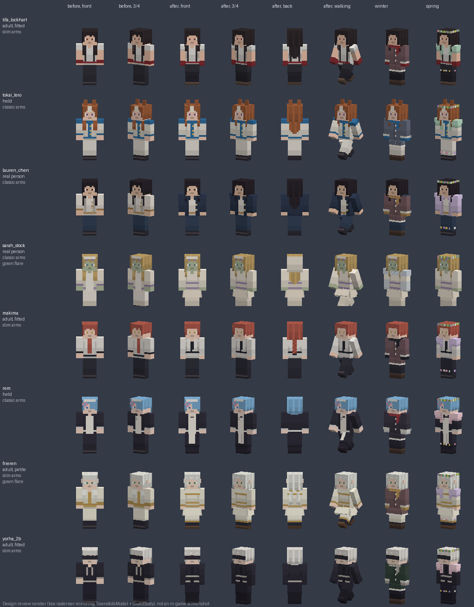
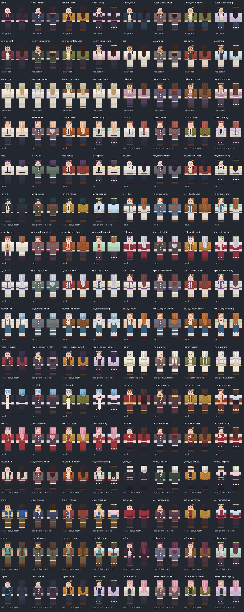

# JZE guest appearances — November 11 local implementation

## Complete detailed roster, November 19

OpenAI Codex (GPT-6) completed the 32 available guest models. The final seven are Frieren, Rem, Megumin, Zero Two, Rin/Ishtar, Hoshimi Miyabi and Nicole Demara. Their detailed rigs use the same imported body presets, head and hair library as the approved lineup. Distinctive pieces include Frieren's long silver tails and drop earrings, Rem's white apron and headdress, Megumin's angled hat, Zero Two's red horns, Rin's ribbon ties, Miyabi's fox ears and split coat, and Nicole's cropped jacket and utility pouch. Existing guest IDs carry the new appearance into saved towns.

## Source body geometry and crop tops, November 19

OpenAI Codex (GPT-6) rebuilt fifteen roster fittings on the owner's Roblox body presets. Preserve the imported torso, leg triangles and surface normals when adding new clothes. Paint fitted fabrics directly on those surfaces and fit collars, hems, armor connectors and skirts to the wearer. Each new crop top needs painted abdominal contours, a navel and a soft shadow under the hem. Brittany's cream GREENWICH tee and Sarah's evergreen cropped knit use this treatment in the detailed model and coordinated compact skins.

All 66,270 original torso and leg faces across these fifteen guests matched their source geometry and normals after accounting for stature and standing pose. The nine models and textures in the owner's approved Minecraft lineup matched the saved assets byte for byte. Reze also matched the original clothed import. Eight guest asset tests passed. The offline Minecraft gallery captured front and profile views for all seventeen guests in this review, including Himeno and Reze. The packed Blender and Blockbench exports were verified against the game assets.

## Restored Reze and individual roster fittings, November 19

OpenAI Codex (GPT-6) restored the complete clothed Reze avatar from the owner's Blender export. The normal outfit uses the original black cropped sweater, piped drawstring shorts, pendant, violet hair, green eyes, hands and rig proportions. The source comparison checks all 21,650 normal-outfit faces and the pixels in all nine material assignments. A regression test checks that same appearance from the packaged assets.

The remaining fifteen guests in this batch and Asuka use explicit fitting choices. The garment generator samples each wearer's torso through the chest, waist and high hip and fits the garment with its attached trim. Coats have more room than knits and satin. Trouser legs and racing suits retain the selected hip and thigh shape and taper towards the boots.

Emiru keeps the lace and ivory ruffles, Pokimane the fitted charcoal satin, and Brittany the GREENWICH tee and sage wrap skort from the owner's photographs. AOC wears a wine wrap dress, Lauren a striped fitted knit, and Sarah a green ribbed top and dark jeans. Power has a field jacket and trousers, Asa a charcoal jacket and skirt, and Himeno her black halter with silver binding. The racers retain their individual team colors, bibs and equipment. Rei and Asuka keep their Unit-00 and Unit-02 pilot suits.

Seven guest asset tests and the offline Minecraft guest gallery passed. The gallery produced front and side captures for the sixteen and Asuka. All seventeen packed Blender rigs passed the head-turn check, and the Blockbench exports matched the Minecraft meshes, joints and textures.

## Emiru, Pokimane and Brittany Venti wardrobe, November 19

OpenAI Codex (GPT-6) fitted these three looks to the owner's supplied photos, in attachment order.

- Emiru wears a black floral-lace bodice with a crossed neckline, a silver pendant, a tiered black skirt with an ivory lace edge and ivory cable-knit stockings. Long, dark face-framing locks fall to the skirt.
- Pokimane wears a charcoal sleeveless shirt dress with a pointed collar, gathered satin, a fitted waist with stitched channels, a flared hem and gold bracelets. The long waves have warm brown highlights.
- Brittany Venti wears a cream cropped GREENWICH tee, a sage wrap skort with three buttons, ankle socks and white sneakers. The tee and skort use the fuller guest base with a fitted waist. Dark curls gather into a high ponytail.

The Emiru and Pokimane photos end above the feet. Their game outfits use dark flats. The same three guest IDs use the new fabrics on the detailed rigs and coordinated colors on the four compact wardrobe skins per guest.

The final three rigs were captured from the front and side on NPCs in the offline Minecraft client. All six guest skin tests passed. The editable Blockbench models matched the game meshes, pivots and atlases, and each Blender rig passed the packed-texture and head-rotation checks.

## Playable adult editions, November 19

All 32 available guests appear as adults in Jugcraft. Four unresolved entries have no playable edition. Asuka and Rei keep their existing guest IDs and their Unit-02 and Unit-00 pilot suits at age 18. Their adult editions apply to existing saves and future placements because the edition belongs to the roster entry. Each seasonal outfit uses the same guest identity.

The other twelve time-skip guests are Power, Reze, Asa, the five Uma racers, Rem, Megumin, Zero Two and Rin/Ishtar. Their guest screens identify them as adults in Jugcraft's time skip. No numerical age was specified for these twelve. The existing companionship and marriage settings are independent of the appearance edition.

Reze keeps the supplied face and hair with a café apron, work shirt and trousers. Asa wears a jacket with an archive pass. Teio, Gold Ship, Oguri Cap and Special Week wear numbered competition kits. Agnes wears her research coat and Power her field uniform. The compact skins for Reze, Asa, Rem, Megumin, Zero Two and Rin have matching occupational details across all four outfits. Tamsin and Ione remain optional, separately named concepts outside the roster.

OpenAI Codex (GPT-6) verified all fourteen time-skip profiles in the offline Minecraft client. The six skin tests passed, and the eight revised Blockbench exports matched their Minecraft meshes, texture atlases and joint pivots. The sections below record earlier fittings and owner directions in chronological context.

## Original flight crew preview, November 19

Tamsin Vale, 34, flies air-sea rescue in a petrol-teal suit with a high-visibility diagonal stripe, shoulder radio and boom microphone. Ione Calder, 37, flies high-altitude surveys in plum and graphite with a navigational eyepiece and a rear instrument canister. Both use the owner's medium-bust, fuller-hipped body fitting (`medium_full`). They are original characters with their own names and guest IDs reserved for these local previews.

OpenAI Codex (GPT-6) built the two studio models from the shared fitting library. The editable models use the imported head rig with individually fitted faces and hair (source hair 5 on Tamsin, 26 and 16 on Ione). The three-angle sheet was rendered from the indexed models and their final atlases. The Blockbench exports passed geometry, texture and pivot checks. Both Blender armatures reopened and posed with their embedded textures.

## Asuka and Rei pilot suits, November 19

In Jugcraft's time skip, Asuka Langley and Rei Ayanami are both 18. Their guest profiles show the age and identify them as EVA pilots. Both models use the medium body preset, longer proportions, and a head scaled to 81% about the neck, including hair and interface clips.

Asuka wears red Unit-02 armor with orange collar panels, charcoal gloves and long copper hair gathered at the sides. Rei wears an ivory Unit-00 suit with blue-gray limb panels, red fittings and a short pale-blue bob. Both suits have a closed neck, a stenciled unit number, a rear connector and matching seasonal fallback skins. The appearance changes preserve the existing guest interactions.

To rebuild this pair, use the portrait generator below with `--only asuka_langley rei_ayanami`. Pass the same two IDs to `tools/guest_editable_lineup.py` to export a centered, packed Blender scene.

OpenAI Codex (GPT-6) verified both front and side views on NPCs in the local Minecraft client and read the age line in each guest screen. The guest client game test and all six fallback-skin tests passed. Both Blockbench models matched the game geometry and atlas, and the packed Blender scene reopened with two working armatures.

## Nine adult guest wardrobe revisions, November 19

OpenAI Codex (GPT-6) revised the eight adult fictional guests from the first fitting and Himeno from the second. They use the owner's fitted Roblox rig and their existing character faces, hairstyles and head accessories. The head and its attached parts scale together about the neck to 89% of the previous size. The earlier fittings remain available for visual comparison.

| Guest | Revised outfit |
| --- | --- |
| Chun-Li | Blue fighting shorts under shorter, gold-edged qipao panels, ivory side insets and lace-up boots |
| Tifa Lockhart | Ivory crop tank over a burgundy sports layer, hip straps and an asymmetric wrap over fighting shorts |
| 2B | Fitted black bodice with a lattice inset and a flared, ivory-bound skirt cut high on one side |
| Ada Wong | One-shoulder crimson dress with black binding, long gloves and an upswept hem |
| Lara Croft | Teal crop top over a charcoal sports layer, belted hiking shorts and her field pack |
| Kafka | Open plum jacket framing a wine-colored underlayer, hip straps, shorts and thigh-highs |
| Makima | Cropped white shirt with pointed front, black tie, tailored shorts and smoke-colored stockings |
| Misato Katsuragi | Cropped red jacket over a plum top, silver cross and an angled black mini skirt |
| Himeno | Black halter over a plum bralette with silver binding, shorts, hip straps, thigh-highs and her eyepatch |

The skirt fitting samples both legs in the renderer's standing pose at the actual height of each point on the hem. The shorts sit on the leg joints beneath each moving panel. To reproduce just this group, run the portrait generator documented below with `--only chun_li tifa_lockhart yorha_2b ada_wong lara_croft kafka makima misato_katsuragi himeno`.

The nine models use seven body presets. Studio inspection covered front, profile and rear views. For Tifa, 2B, Ada and Misato, all 396 sampled skirt vertices and face centers per guest cleared the standing torso and legs. The packed Blender file reopened with nine poseable rigs and embedded textures. Each of the nine Blockbench files matched its Minecraft texture bytes, joint pivots, face indices and sampled UVs.

The offline Minecraft guest gallery passed with the final resources and captured all nine front and profile views. The six fallback skin tests also passed.

## Next sixteen in owner-selected roster order, November 19

The sixteen guests below use the imported Roblox rig. Reze wears the complete outfit from the owner's Blender file. Her open green eyes, violet hair, black knit top, heart pendant and piped drawstring shorts are part of that import. The white top in the owner's follow-up photos is a different outfit. The other fifteen use individual face atlases, hair fittings and clothes.

| Guest | Hair source | Details in the revised models |
| --- | --- | --- |
| Emiru | Handles 13 and 48 | Dark fringe, lilac varsity jacket with a heart, dark pleats and lilac shoes |
| Lauren Chen | Handles 13 and 16 | Long dark hair, navy-and-cream striped knit and cream trousers |
| Brittany Venti | Handles 5 and 16 | Chestnut curls, burgundy wrap top with a diagonal gold seam and dark trousers |
| AOC | Handle 5 | Side part, ivory double-breasted vest and wine trousers |
| Sarah Stock | Handles 13 and 16 | Natural complexion, blonde hair with two barrettes, evergreen ribbed top, dark jeans and brown boots |
| Pokimane | Handles 5 and 48 | Brown curls, rose tennis jacket with a crescent and a plum pleated skirt |
| Power | Handles 13 and 16 | Red horns, amber cross-shaped pupils, rolled sleeves and a navy jacket |
| Reze | Original fitted avatar | Imported face, hair, clothes, jewelry and hands |
| Asa Mitaka | Handles 13 and 48 | Dark tied hair, pleated charcoal pinafore, white collar and red bow |
| Himeno | Handles 42 and 48 | Tousled dark hair, eyepatch, cropped black halter with silver piping, shorts, opaque tights and tall boots |
| Tokai Teio | Handles 59 and 16 | Chestnut ponytail, white blaze, blue racing sash and gold skirt trim |
| Agnes Tachyon | Handles 42 and 61 | Red eyes, roomy lab coat with patch pockets and lace-up boots |
| Gold Ship | Handles 13 and 48 | Silver mane, gold-trimmed cap, earpieces and a red naval coat |
| Oguri Cap | Handles 5 and 16 | Silver mane, blue-and-gold headband and a navy sailor bib |
| Special Week | Handles 47 and 16 | White forelock, purple ribbon and plum seams on the racing bodice |
| Rei Ayanami | Handles 47 and 61 | Pale blue bob, red eyes and a teal uniform with a white collar and red bow |

Sarah's first fitting used a zombie-bride costume. The revised model and all four fallback skins use a natural complexion. The fallback renderer now draws her jeans with separate legs. Each racer's rig has ears and a tail with its own joint that sways with the walk cycle. The racers' heights follow the official character profiles. [Tokai Teio](https://umamusume.jp/character/tokaiteio/), [Agnes Tachyon](https://umamusume.jp/character/agnestachyon/), [Gold Ship](https://umamusume.jp/character/goldship/), [Oguri Cap](https://umamusume.jp/character/oguricap/), [Special Week](https://umamusume.jp/character/specialweek/)

After the Blender extraction described below, generate the runtime resources and Blockbench models with `python tools/guest_roblox_portraits.py EXTRACTED BODY_FIT_LIBRARY REVIEW_DIR --next-sixteen --fitted-avatar FITTED_AVATAR_DIR`. The last directory is the original clothed export containing `roblox-guest.json`, `roblox-guest.png` and `charts.json`. The Blender lineup exporter accepts the guest IDs after the output path and lays them out in rows of eight.

A comparison of Reze's normal outfit against the imported mesh matched all 21,650 faces, including positions relative to the rig, normals and UV coordinates. All nine source material charts retained their original pixels. The selectable hair uses a child joint at the original head pivot. Seasonal layers use a previously empty corner of the atlas.

Both local client tests passed with the final assets. `GuestClientGameTests` selected each guest's mesh and atlas on a spawned NPC and captured 32 front and profile views. `GuestWardrobeClientGameTests` exercised seasonal layers and held items. A fresh Blender process reopened the sixteen packed rigs and checked that turning a head moves its hair independently of the legs. All sixteen Blockbench models matched the Minecraft positions, pivots, face indices, sampled UVs and texture bytes.

## First eight guests with the imported Reze face, November 19

The current eight client models use the head mesh and face UVs from the owner's
`roblox-avatar-rigged.blend` fitting. The Roblox add-on chat supplied the packed
`jugcraft-roblox-library/roblox-model-library.blend` and its catalog. The table
identifies the source mesh objects inside that library. OpenAI Codex (GPT-6)
fitted the hair to each head, adapted the painted face and tailored the clothes
to the approved body presets.

| Guest | Library hair and accessories | Character details |
| --- | --- | --- |
| Chun-Li | Handle49 | Covered twin buns, ivory ribbons, warm brown eyes and a gold-edged split tunic |
| Tifa Lockhart | Handle13 and Handle16 | Long dark hair with a layered center fringe, burgundy eyes and red fighting gloves |
| YoRHa 2B | Handle47 and Handle48 | Silver bob, blue-gray eyes under a removable fitted visor and an embroidered skirt |
| Ada Wong | Handle23 and Handle42 | Short, side-swept black bob, lifted eyeliner, a half smile and a red high-neck dress |
| Lara Croft | Handle26 and Handle16 | Chestnut braid with a separate swept fringe, hazel eyes and a field pack |
| Kafka | Handle5 and Handle63 | Wine-colored hair, violet eyes, crown-mounted glasses and a split coat |
| Makima | Handle26 | Copper-red braid and blunt fringe, gold eyes with three concentric red rings and a black tie |
| Misato Katsuragi | Handle19 and Handle20 | Feathered violet hair, an open smile, cropped red jacket and silver cross |

The face, hair and removable head accessories have separate bones in the editor.
The lower braids on Makima and Lara follow the existing guest braid animation.
The Blender lineup contains eight independently poseable rigs with packed images.
Each Blockbench file embeds the same 2048-pixel atlas the game loads.

To reproduce this pass, run Blender in background mode with script auto-execution
disabled. Pass `--python tools/guest_roblox_sources.py -- RIGGED_AVATAR.blend LIBRARY.blend EXTRACTED`.
Then run `python tools/guest_roblox_portraits.py EXTRACTED BODY_FIT_LIBRARY REVIEW_DIR`
from the checkout. This writes the runtime resources and the eight Blockbench files.
The packed Blender lineup uses `--python tools/guest_editable_lineup.py -- OUTPUT.blend`.

The local `GuestClientGameTests` run passed with all 16 final resource files
matching the checkout. The gallery captured front and profile views of all eight
at four blocks, plus Misato's rear and opposite profile. A fresh Blender process
opened the packed scene and verified that turning each guest's head carries its
hair while the legs stay planted. The Blockbench check compared the embedded
images, vertex coordinates, joint origins, face indices and sampled face UVs
with the Minecraft resources.

## November 19 body fitting prototype

The current review uses one clothed mannequin with a dark sleeveless top, opaque pale trousers and a pair of green chibi eyes. The owner's November 19 front, back, profile and hand references set the proportions. The bent arms and bevelled open grips belong to the moving arm bones. The waist divides into two independently moving legs with broad, flat trouser hems.

OpenAI Codex (GPT-6) revised the same mannequin for the owner's next fitting. The shirt spans two rounded chest forms and draws in through the abdomen. Fuller upper thighs taper into the original lower-leg shape. The comparison uses matching camera angles, lighting and textures for both versions.

OpenAI Codex (GPT-6) then rebuilt the shoulder-to-wrist profile around the elbow bend, rounded the open palm and softened the cheek, fringe and crown. All three eyes-only expressions use this same geometry and pose. The review compares the earlier and revised arms from the front and side, and each expression head-on and at three quarters.

The three-way local Minecraft review displayed the versions in Misato, Makima and 2B's client resource slots.

The local `GuestClientGameTests` gallery passed with the final mesh and all three textures. The front captures show the expressions on the same mannequin in daylight. The profile and rear captures show the arm and wrist contours. Each Blockbench file embeds its matching atlas.

The owner chose the wide green eyes. In the subsequent head study, OpenAI Codex (GPT-6) rounded the crown, filled out the cheeks, and gave the short violet hair an asymmetric split fringe with tapered tips at the cheekbones and collar. Two shallow painted curves form a small catlike smile. The owner's supplied image guided this revision. Run `python tools/guest_body_fit.py OUTPUT_DIRECTORY` to export the selected wide-eyed model and its embedded Blockbench texture. The `--eyes` option still selects individual lid shapes. This study covers one local mannequin.

The revised head passed the local `GuestClientGameTests` gallery. Its four daylight captures show the smile from the front, the layered fringe in profile and the tie at the nape. The Blockbench mesh and embedded atlas matched the Minecraft export.

In the next local fitting, OpenAI Codex (GPT-6) narrowed the complete head and hairstyle to 85% of their previous width. The wide-eyed face now has pale plum brows, a light wash at the outer lids and tapered eyeliner. The trouser waistband continues into a curved lining between the independently articulated thighs. Matched front and rear renders and opposite 30-degree stride poses document the fit. The export check confirmed the head height and depth, hair UVs, arm meshes, joint positions, lower trouser cut and smile match the preceding version.

The local Minecraft `GuestClientGameTests` gallery passed with the narrower head and revised trousers. Its four standing views complement the separately posed stride renders.

OpenAI Codex (GPT-6) trialled the upright stance and lower-rib taper on the same local mannequin. The narrowest part of the knee now sits 0.17 model pixels ahead of the centre of the grounded cuff in profile, down from 0.64. The shirt carries more depth through the lower ribs and eases into the waistband. The maximum chest projection and standing height match the preceding fit. The comparison uses the same scale and camera positions for both versions, with separate views of the left and right stepping poses.

### Roblox fitting trial

OpenAI Codex (GPT-6) used a copy of the owner's open Blender scene for a local guest fitting. The source contains 15 Roblox body pieces, hair, a necklace and two garments. The fitting copy adds a 16-bone armature, packs the original textures, composites the Roblox skin-color overlays and retains the garment adjustments as editable shape keys. The portable GLB passed a fresh import and walking-pose checks for the sleeves, shorts, hand and foot.

The Jugcraft fitting exports the dressed rest mesh and a shared texture atlas to the guest renderer's six moving parts. The Blender file carries the articulated elbows, wrists, knees and ankles. The separate body-preset study is paused for this review.

The local Minecraft guest gallery passed with the imported geometry and atlas. Front, rear and both profile captures show the source face, hair and outfit. The shorts still show a small amount of clipping near the side seams. The temporary test resource slot was restored after capture.

### Wardrobe fittings from the approved Roblox body

OpenAI Codex (GPT-6) built 13 anonymous, matte fitting forms directly from the 14 torso and limb meshes in the rigged Roblox import. The Blender master retains the 16-bone armature, including the empty head attachment, the source UVs and the walk action. Fit 00 is the imported small-bust, medium-seat shape. Comparison against the source Blender file verified its rest vertices, polygon order, vertex weights, UV coordinates and bone transforms. Fit 07 carries the stronger thigh profile requested for Chun-Li.

In the master file select **Wardrobe mannequin**, open **Object Properties → Custom Properties**, and set **Body fit** to a number from 0 to 12. The Blender text named **Fit index** lists the shapes. The shipped GLB, Blockbench and Jugcraft files each contain a single preset. The 13 meshes share vertex topology across presets. Heads and outfits attach separately.

The local Minecraft guest gallery passed for fits 00, 07 and 10, with front and profile screenshots for each. Reopening the Blender master verified all 13 selectors and opposing stride poses with script auto-execution disabled. All three export formats contain 13 distinct shapes.

To rebuild, open the rigged import as the input to Blender in background mode and run `tools/roblox_body_forms.py -- OUTPUT` using Blender's `--python` option. Run `python tools/roblox_body_blockbench.py OUTPUT` from the checkout to create the Blockbench files with their embedded texture and the shared game atlas.

### Reze outfit and idle study

The owner reserved these ideas for a future Reze look. Try a black square-neck knit top with broad straps, a ribbed waist and plum trim. Pair it with high-waisted opaque trousers, curved pockets, a small silver buckle and a slight flare over short black boots. Tuck the fringe behind one ear to show a small silver hoop and the green eyes with fine winged liner. Try a relaxed idle with the weight on one foot, the opposite knee loose, one shoulder lowered and a slight head tilt toward the player. These are outfit and pose ideas for Reze's existing roster model.

## November 19 model review, batch one

Chun-Li, Tifa Lockhart, 2B, Ada Wong, Lara Croft, Kafka, Makima and Misato Katsuragi
have individual, locally authored Minecraft rigs. Chun-Li has a wide fighting stance,
faceted quadriceps, covered buns, ribbon tails and gold brocade. Tifa has a fighter's
harness, plated gloves and a pleated skirt. 2B has a bob, visor and embroidered bell
skirt. Ada has an asymmetric fringe, high-neck red outfit and thigh holster. Lara has
a jointed braid, field pack and twin belt holsters. Kafka has crown-mounted glasses
and split coat tails. Makima has ringed eyes, a long plait and a knotted office tie.
Misato has a violet fringe, cropped red jacket and silver cross.

The earlier `tools/guest_portrait_models.py` prototype generated the rig files under
`town_models/guests` and the eight corresponding texture atlases under
`textures/entity/town_guests`. The palette comes from Jugcraft's existing guest
skins. Geometry, facial pixel art and garment patterns were authored in OpenAI
Codex (GPT-6), using the owner's visual references. The models use the Deepstead
box layout and town humanoid poses. Winter adds lined sleeves and a scarf, harvest
adds a collar and leaf pin, and spring adds a floral pin and collar. Each character's
four outfits share one atlas. Selecting a player skin uses the existing player model.
This first review batch changes client presentation for existing guests.
The local Minecraft guest and wardrobe galleries passed for this batch. The guest
gallery checks the model actually submitted for rendering. In-game screenshots
were also inspected for all eight characters after fixing the renderer selection.

The owner requested a second pass on these same eight before extending the style
to the next group. The face is now painted on a tapered cheek panel. The upper lids,
iris highlights, eyebrow angles and lip shapes define each expression. The jaw joins
the cheeks, and the nose is painted into the face. Hair locks narrow to tips. The
collarbone, bodice, waist and leg panels follow shared outlines to give garments a
continuous silhouette, including Chun-Li's wider stance.

The guest baker preserves the ordinary cuboid path for accessories and submits
the contoured panels' vertices explicitly. Sodium caches ordinary cube bounds at
construction, so changing their polygon arrays alone loses the silhouettes in game.
For visual review the guest gallery now turns a stationary guest toward the player
and captures each at talking distance.

Both local Minecraft galleries passed with Sodium 0.9.2 on Minecraft 26.3. Together
they produced 76 screenshots. The eight frontal views were inspected together.
The six existing guest skin tests also passed, and the eight rig files and eight
atlases matched the copies used in the client run.

The following sections document the previous player-layout designs, which still
supply the rest of the cast and the original skin resources.

The earlier filename audit found no supplied named-character skins among 48,060 asset filenames. This pass authors new Minecraft-style interpretations in the existing editable `tools/town_skins.py` UV system, through `tools/guest_skins.py`. It does not download or overwrite another creator's skin or any owner-library original.

## Implemented

32 separate 64×64 player-layout skins, each in four outfits (128 files); opaque base faces, transparent hair/clothing layers, restrained palettes and single-row eyes. The existing town humanoid provides movement. Small closed model accessories add Uma/Miyabi ears, Power/Zero Two horns, Frieren ears and Megumin's stepped hat. These are stylized interpretations, not exact portraits or owner-approved final likenesses. Real-person clothing is a representative everyday outfit, not a claim about that person's identity, beliefs or endorsement. Sarah's nongraphic zombie bridal variant is the owner's requested fictional costume and stays non-gory in every outfit.

## November 11 fallback skin specification (historical; adult editions updated November 19)

Romance is only for guests who are unambiguously adults; the same rule governs body shape. The generator records it as four groups (`HELD`, `REAL`, `FITTED`, `PETITE` in `tools/guest_skins.py`), and `scripts/tests/test_guest_skin_assets.py` checks them against the roster, `client/GuestBody.java` and the packaged files.

- **Held (14): asa_mitaka, tokai_teio, agnes_tachyon, gold_ship, oguri_cap, special_week, rei_ayanami, asuka_langley, rem, megumin, rin_ishtar, and power, reze, zero_two (age uncertain).** Characters shown as minors or school students, or whose age is uncertain: age-appropriate, straight proportions, classic 4-pixel arms, no curves, no shaping and no sexualised anatomy in skins or geometry; no flare panels; no aged-up or "adult alternate" versions; their seasonal outfits are the same age-appropriate coats, cardigans and flowers. Clothing and hair only (school skirts end at the knee with socks or tights below).
- **Real people (6): emiru, lauren_chen, brittany_venti, aoc, sarah_stock, pokimane.** Respectful, non-exaggerated likenesses: clothing and hair only, classic arms, no body emphasis. Sarah Stock's gown flare is clothing.
- **Adult fictional, fitted (11): makima, himeno, misato_katsuragi, tifa_lockhart, yorha_2b, chun_li, ada_wong, lara_croft, kafka, miyabi, nicole_demara.** Slim 3-pixel arms and modest shaping only: a rounded shoulder seam and a slightly darker, tapered waist seam on the outer torso columns.
- **Adult fictional, petite (1): frieren.** Slim arms only, no tailoring.

Nothing is drawn on the chest or hips for anyone. Player-like proportions, the existing UVs, closed geometry and the walking poses are kept; no model part changes size.

## What changed in this pass (worker A, Claude Opus 5.5)

Before: classic arms for everyone, a single hat-layer hair block with long hair as four straight strips on the jacket, outfits as front details over a uniform torso, trousers for everyone except two gowns. After:

- **Layered hair**: a darker under layer with slanted strands on the head; lighter strands, an uneven fringe and face-framing locks on the hat layer, each layer a row shorter than the one beneath; long hair tapering down the jacket layer's back with locks over the shoulders; curls with an uneven edge; Makima's and Lara's braids; Frieren's two tails; a bob's inward curl and nape.
- **Clothing silhouettes on the outer layers**: open blazers and jackets with V lapels (Lauren Chen, Brittany Venti, AOC, Himeno, Misato, Nicole), long coats with tails on the trouser layer (Agnes's lab coat, Kafka, Miyabi), Megumin's cape, Frieren's capelet, Rem's apron, Rei and Asuka's pinafores, collars and high necks; knee-length or shorter skirts on the trouser layer with legwear and shoes below (Asa, Rei, Asuka, Misato, Frieren, Rem, Megumin, Rin, Tifa, 2B, Chun-Li) and Sarah's full-length gown.
- **Slim arms** for the 12 adult fictional guests (the model's existing slim arms; the renderer chooses them through `GuestBody.slim`). Their skins fill the classic arm's two unused columns from their neighbours, so they still read correctly on classic arms.
- **Modest flare geometry** (`client/GuestBody.java`) for Sarah Stock's gown and Frieren's robe only: four closed panels (3×4×1 and 1×4×3 boxes) hung at the hip, standing out 0.12 rad, sampling the skin's unused island at x 56–63, y 16–31. The front and back panels swing with the forward-most and backward-most leg every frame, relative to the body's lean, about the legs' own hip axis (since 13 November, below), so no walking or seated leg passes through them. Never over a player skin.

| Guest | Group | Arms | Hair | Outfit | Below the waist |
| --- | --- | --- | --- | --- | --- |
| emiru | real person | classic | long | hoodie | trousers |
| lauren_chen | real person | classic | long | navy blazer over a blouse | trousers |
| brittany_venti | real person | classic | curls | blazer over a blouse | trousers |
| aoc | real person | classic | long | light suit jacket | trousers |
| sarah_stock | real person | classic | long, veil | non-gory bridal gown | gown, flare |
| pokimane | real person | classic | curls | hoodie | trousers |
| power | held | classic | long | shirt and tie | trousers |
| makima | adult, fitted | slim | braid | shirt and tie, belt | trousers |
| reze | held | classic | bob | shirt and tie | trousers |
| asa_mitaka | held | classic | long | school shirt and ribbon | knee skirt, dark socks |
| himeno | adult, fitted | slim | bob, eyepatch | suit jacket, shirt, tie | trousers |
| tokai_teio | held | classic | long, ears | racing outfit | trousers |
| agnes_tachyon | held | classic | bob, ears | lab coat over a vest, long sleeves | trousers |
| gold_ship | held | classic | long, ears | racing outfit | trousers |
| oguri_cap | held | classic | long, ears | racing outfit | trousers |
| special_week | held | classic | long, ears | racing outfit | trousers |
| rei_ayanami | held | classic | bob | school shirt, pinafore | knee skirt, white socks |
| asuka_langley | held | classic | long | school shirt, pinafore | knee skirt, white socks |
| misato_katsuragi | adult, fitted | slim | long | red jacket over a dark dress | skirt, tights |
| frieren | adult, petite | slim | two tails, elf ears | capelet and white dress | skirt, tights, boots, flare |
| rem | held | classic | bob, clip | maid dress and apron | skirt, dark tights |
| megumin | held | classic | bob, hat | robe and cape | skirt, tights, boots |
| zero_two | held | classic | long, horns | uniform jacket | trousers |
| rin_ishtar | held | classic | long | high-necked sweater with cross | skirt, black tights |
| tifa_lockhart | adult, fitted | slim | long | top with suspenders, gloves | skirt, leggings |
| yorha_2b | adult, fitted | slim | bob, visor | dark dress, long sleeves | skirt, tall boots |
| chun_li | adult, fitted | slim | buns | qipao with gold trim | qipao skirt, tights, white boots |
| ada_wong | adult, fitted | slim | bob | high-necked top, gloves, belt | trousers |
| lara_croft | adult, fitted | slim | braid | tank top, backpack, gloves, belt | trousers, boots |
| kafka | adult, fitted | slim | long, glasses | long coat over a shirt | trousers |
| miyabi | adult, fitted | slim | long, ears | long coat | trousers |
| nicole_demara | adult, fitted | slim | long | open jacket over a dark top | trousers |

## Pose alignment (13 November, worker D, Claude Opus 5.5)

The accessories, held items and the flare were checked against the guest body in the model's own coordinates (the skinnable layer of `client/TownsfolkModel.java`, the parts in `client/GuestBody.java`). Offsets and pivots only: no part changes size, no texture or UV changes.

| Checked | Finding | Change |
| --- | --- | --- |
| Held items on slim arms (also noted in custom-npcs.md) | The item was placed from the classic arm's pivot (−5, 2): half a pixel outward and half a pixel higher than vanilla's slim player places it (−4.5, 2.5). Layers drawn on the arm sat half a pixel above a slim arm. | While slim arms show, the arms' pivots move half a pixel in and down (`TownsfolkModel.SLIM_SHIFT`) and the slim boxes are offset back out, so they stand exactly where vanilla's slim arms do and the hand's item is where vanilla holds it. Classic arms are unchanged. |
| Frieren's ears against the hair (hat) layer | The 1-pixel ears began on the head's side (x ±4); the hair layer stands 0.5 out, so only half a pixel showed. | They begin on the hair layer's sides (x ±4.5, `GuestBody.ELF_EAR_INNER`) and stand a whole pixel proud, at the same height. |
| Flare front and back panels against the legs | Hinged at the waist's front and back (z ±2.1), they turn about a different line from the legs (z 0): a leg striding about 0.4 rad or more passed through the front panel, and seated (vanilla's passenger pose) the front panel lay inside the thighs. | They turn about the legs' own hip axis, their inner faces 2.1 from it (`FLARE_GAP`), starting `FLARE_DROP` down so at rest they stand where they did (within 0.02 px). No point of either panel enters a leg for strides up to a radian or seated. Side panels unchanged. |
| Uma and fox ears, horns, Megumin's hat against the hair | Ears rise 3 px and horns 2 px above the hair's top (−8.5), their bases inside the head; the hat's brim (−9 to −8) encloses the hair's top, which shows below the brim. | None. |
| Armour over the flare | The townsfolk renderer has no armour layer and guests are never given equipment; the cosmetic layers registered for every humanoid draw only for chest or head items guests never wear, and the harvest costumes skip custom NPCs (`seasonalTownResident`). | None (not applicable in play). |

The visible effect of these changes is a hypothesis until the client test's screenshots are inspected: `GuestWardrobeClientGameTests` (written, not run) measures the arms' pivots for every guest of its set in every outfit, Frieren's ears and the flare panels against walking and seated legs on the baked layer, and takes close-ups of a book in a slim and a classic hand (`guest_pose_held_slim`, `guest_pose_held_classic`).

## Seasonal outfits (owner-selectable)

`town/guests/GuestWardrobe.java` holds each guest's outfit in its own saved data, `jugcraft:town_guest_wardrobe` (versioned; entries it cannot read and outfits from a newer version are kept as written). Operators choose with `/guests outfit <guest|all> <normal|winter|harvest|spring>` and read it back with `/guests outfit <guest|all>`; the `outfit` node requires permission level 2 and every command checks again on the server (the shared `/guests` root carries no requirement).

| Outfit | Texture | What it adds (same face and hair) |
| --- | --- | --- |
| normal | `guest_<id>.png` | the named skin |
| winter | `guest_<id>_winter.png` | a closed winter coat (a deep colour per guest), a scarf in the guest's accent colour, mittens, boots; Sarah: a silver stole and long gloves over the gown |
| harvest | `guest_<id>_harvest.png` | an open knitted cardigan in a harvest colour, a leaf pin, brown boots; Sarah: a knitted shawl and an amber hem band |
| spring | `guest_<id>_spring.png` | a light bolero (or a light spring jacket instead of a coat), small flowers at the hem, a flower crown |

An outfit is worn through `CustomNpcs.setTownSkin`, as the appearance migration does, only by the guest's canonical, available entity while it wears one of its own looks (its named skin, an outfit's, its placement stand-in or the exact historical stand-in). A different operator-selected town skin, another guest's skin, or a pending or resolved player skin is never overwritten; the choice waits until the guest wears its own look again. Nothing changes while any player-skin lookup is in flight, so an operator's lookup is never cancelled. "normal" restores the named skin. A guest that is not loaded changes when it next loads: once a second the wardrobe looks up chosen guests' canonical entities among loaded entities only, never loading a chunk. No relationship, ledger, affection or economy state changes.

Textures live in `src/main/resources/assets/jugcraft/textures/entity/townsfolk/`. Rebuild with `python tools/guest_skins.py`. The generator also writes `build/jze-guest-skins.png` and `build/jze-guest-outfits.png`, explicitly labelled front/back UV previews, not runtime evidence.

## Reference direction

Owner's named roster is the design brief. Character pages consulted for the series' designs include [Chainsaw Man](https://www.chainsawman.dog/movie_reze/character/), [Uma Musume](https://umamusume.jp/character), [Agnes Tachyon](https://umamusume.jp/character/agnestachyon/), [Frieren](https://frieren-anime.jp/character/), [KonoSuba](https://konosuba.com/1st/character/) and [Zenless Zone Zero](https://zenless.hoyoverse.com/en-us/character). No assets from those websites are bundled. Rin/Ishtar uses the Rin outfit for the shared identity; changing the outfit must not create a second identity. (The November 11 silhouette and outfit pass used no web research; it reworks the existing designs.)

## Remaining reference holds

Rooni, Remielle, the unnamed guest and Jakeey's K-pop picks remain unavailable until identified. An appearance/race description does not establish a person's identity. The owner has been asked for names or reference links. Detailed visual acceptance of all newly drawn skins remains a local playtest step.

## Integration

`CustomNpcs.townSkins()` accepts the packaged guest skins. Saved canonical guests wearing their exact historical development stand-in migrate on their ordinary service tick; different operator-selected town skins, named skins and pending/resolved player skins are preserved. Neither migration nor appearance assignment changes blocks or identity/affection/marriage records.

The seasonal skins, slim arms and the flare need a coordinator patch to three coordinator-owned files (worker A's report has it exactly): `CustomNpcs.townSkins()` also accepts `GuestWardrobe.skins()`; `TownsfolkRenderer` sets `state.slim = GuestBody.slim(state.skin)` for a town skin; `TownsfolkModel` adds `GuestBody.addParts(body)` to the skinnable layer, poses the flare after the legs, and shows the head accessories by `GuestBody.guest(state.skin)` so they follow a guest into its outfits. Until it is applied, the seasonal skins are refused and slim skins draw on classic arms through their filled fallback columns.

`/guests city preview` lists clear loaded lawn sites; `/guests city place` rechecks permissions and places only never-placed identities. Existing/missing canonical identities are not silently relocated or duplicated. Only creative operators in the Overworld can use city placement. It requires a three-by-three clear grass margin, avoids resident spots and nearby entities, loads no chunks and writes no blocks. Crowded or owner-edited sites are skipped; `/guests place` remains available for individually selected locations. No live city placement was performed.

## Tests

- `scripts/tests/test_guest_skin_assets.py` (run in this pass, passes): all 128 skins packaged, reproducible and unique; opaque base in slim and classic layouts; nothing outside the UV regions; the flare island only on the two flared gowns; outfits keep the face and hair; the body groups match the roster, `GuestBody` and `GuestWardrobe`; shaping appears in exactly the FITTED skins.
- `GuestWardrobeGameTests` (server) and `GuestWardrobeClientGameTests` (client, screenshots `guest_wardrobe_*`): written, not run in this pass; Codex runs them after the patch.
- 13 November (worker D): `GuestWardrobeGameTests.everyOutfitDressesTheRepresentativeSet` dresses the representative set (adult fictional, held, real person, Sarah's dress) through winter, harvest, spring and back; `GuestWardrobeClientGameTests` now shows Frieren too, every seasonal outfit with back views, checks on the renderer's own posed model that arms, flare and head accessories follow each outfit, and adds the pose-alignment measurements above; `test_guest_skin_assets.py` checks all four outfits for every available guest and none for a pending one, and that every accessory and flare box samples an opaque reserved island in every outfit (accessory colours unchanged, flare colours from each outfit's skirt). Python run and passing; game tests written, not run.

Tool attribution: OpenAI Codex, code-authored pixel assets and local Java integration (first pass). Claude Opus 5.5 (worker A, November 11): the silhouette, body-rule and seasonal-outfit pass, GuestBody and GuestWardrobe.

