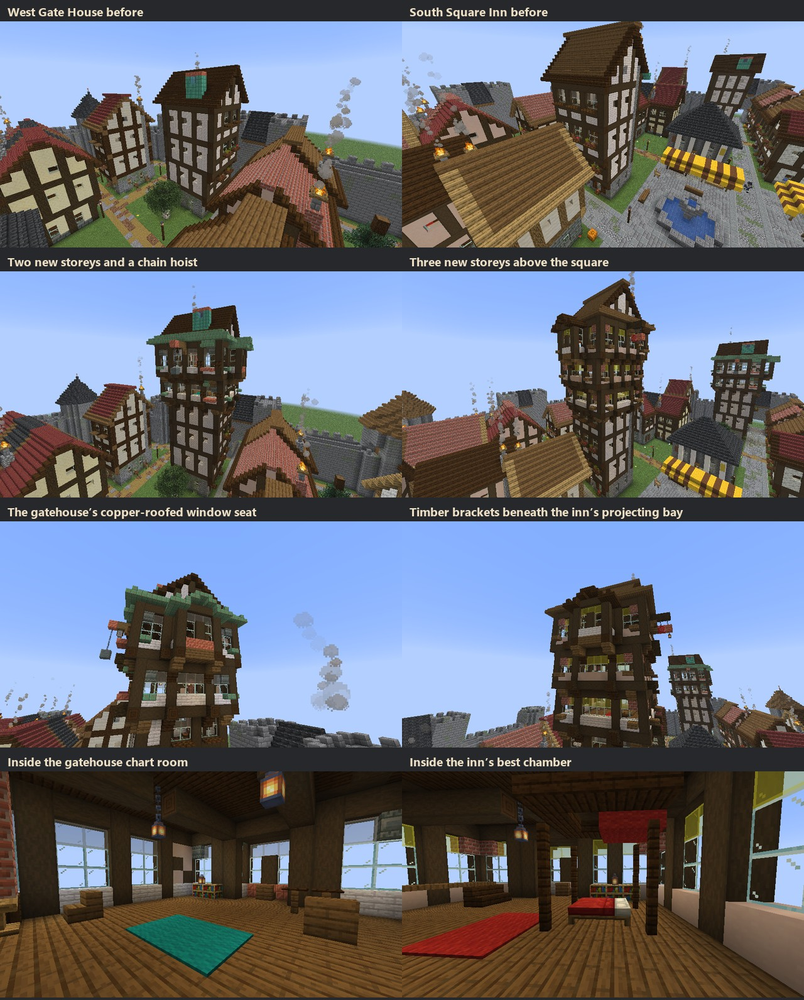

# Original town upper floors and counterweight lifts

The West Gate House, South Square Inn, West Close Cottage and South Lane House each have the first five-block upper storey. Two of them now have additional floors that project over the street on timber brackets. Nineteen lift landings serve the four properties in total.

At the **West Gate House**, ride up two more stops to the work gallery and the chart room. The upper room spans 11 by 11 blocks inside its main walls, with a window seat projecting over the north street. On the east side a timber hoist carries a stone counterweight on an iron chain.

At the **South Square Inn**, three new storeys step toward the square. Look for the copper-and-red hanging sign. The top guest chamber has a four-poster bed, bookshelves, an east-facing window seat and an 11-by-12-block interior. The ceiling rises five blocks above the floor between the beams. These dimensions are measured wall to wall before furniture.

## Using a lift

Stand on the timber platform and use it empty-handed to go to the next landing above. Sneak and use it to return one landing down. Each trip moves one rider. A sound plays at both stops. A workbench makes two landing blocks from five planks, two iron ingots and an iron chain. Stack the stops in the same column, with a clear shaft between them and two clear blocks over each landing. Stops can be up to 32 blocks apart. Occupied or obstructed landings and another tenant's apartment refuse travel.

## Existing towns

New towns build these storeys during original chunk construction. In an existing town, visit the buildings and run `/jugcraft town upperfloors` to preview each property, then `/jugcraft town upperfloors apply` to install the eligible storeys. Older towns first receive the five-block addition. Towns that already have it go directly to the wider floors. The second stage raises the gatehouse roof another eleven blocks and the inn roof another sixteen. Replacement tiles keep their facing, an opening cut for a skylight stays open, and connected dormers, eaves and chimneys travel with the roof. The survey includes the projecting bays and checks for roof additions up to two blocks beyond the original eaves and sixteen above the ridge. An extension continuing beyond those limits or joining another building leaves that house pending.

The command reports obstructions and the coordinates of protected blocks, wet roof pieces, occupied chimneys, containers and incompatible fixtures. Owners can move the obstruction and rerun the command. Nearby buildings and furniture outside the work area stay in place. A house also waits for clear landings, an empty work area, loaded chunks and the current base town revision. Other eligible houses can proceed independently. Before moving a block, the command saves the observed roof and its destination. Repeating an interrupted installation resumes that same move. Completed houses rise once.

## Source and local checks

`tools/town_upper_floors.py` derives the four base overlays from the shipped city blueprint. `tools/town_jetties.py` builds the larger rooms, brackets, hoist and inn fittings with existing blocks. OpenAI Codex authored the additions. Geometry checks cover gables, neighboring roofs, growing interior dimensions, connected floor space and lift clearances. `UpperTownGameTests` exercises lift travel and roof movement alongside storage. `UpperTownClientGameTests` runs the operator command in a generated legacy town, checks a saved partial move and an obstruction in the new footprint, and records street views and interiors.
