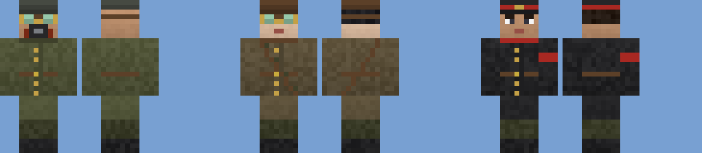

# The raider faction (batch 57)

Status: implemented (pending CI and review)
Proposal issue: none. On 4 October 2026 the owner asked to "do those 1-6... each very carefully and detailed... one at a time with lots of depth". This is idea 3: a dieselpunk raider faction that raids bases, with walkers, blimps and infantry, and can be switched off. It builds on fire control (batch 56) and fortifications (batch 55), which are not merged yet.
Owner: jimbozoomer-byte
Target milestone and tier: steel tier onwards. Raids wait until a player has played for three days.
Primary specialty and supported player role: base defence, and a reason to build the guns, towers and fire control of batches 51–56

## Player experience
Six kinds of raider. All are hostile mobs: sentry guns (batch 56) and town guards fight them.

| Raider | Health / damage / armour | What it does |
| --- | --- | --- |
| **Raider Grunt** | 24 / 5 / 4 | Charges in with a cleaver (an iron axe). Olive greatcoat, steel helmet, goggles and a respirator. |
| **Raider Grenadier** | 20 / 3 / 2 | Lobs small grenades from up to 18 blocks, every 3.5 seconds. Closer than 6 blocks it clubs instead. Brown coat, leather helmet, a bandolier of grenades. |
| **Raider Officer** | 32 / 6 / 6 | **Rallies** every raider within 12 blocks every 2 seconds (Speed and Strength). **When an officer falls, the raiders round them lose heart**: Weakness II and Slowness for 10 seconds, and the rally's Strength is gone. Black coat, red-banded peaked cap, red armband. |
| **Raider Gunner** (slice 10F of the guns) | 20 / 3 / 2 | Carries one of the owner's service arms: a Sentry Pistol (4 in 10), Garrison Rifle (3 in 10) or Breacher (3 in 10). It closes until it can see its target from within its gun's reach (16, 24 or 8 blocks), then fires the gun's own bullets at half their damage: one shot, or a burst of three from the rifle, then a pause of 1.5 seconds. It reloads its magazine in the gun's own time. Its bullets pass through raiders. Grey-green greatcoat, field cap, goggles and a belt of brass rounds across the chest. See [guns.md, slice 10F](guns.md#slice-10f-enemies-with-guns). |
| **Raider Walker** | 120 / 14 / 14 | The Armoured Walker (batch 58, the owner's model) in raider olive and black plate. It wades in and rams with its piston, throwing what it hits. Its hull gun lobs grenades at anything 8 to 24 blocks off, every 5 seconds. It ignores knockback and climbs a block and a half. It has no working drill: **raiders never break blocks**. |
| **Raider Blimp** | 50 / – / 2 | A small airship, the zeppelin's shape at 55% in charcoal canvas with a red band. It cruises 16 blocks over whoever it hunts (never lower than 8 over the ground under it). When within 3 blocks of overhead it drops a bomb every 2.5 seconds. Flak (batch 51) and arrows bring it down. Dying, it noses over. |

### Grenades and bombs
- Every grenade and bomb is a damage-only blast (`weapons/Blast`): **it never breaks, moves or burns a block**.
- Each is smaller than a player's grenade (radius 4, 16 damage):
  - grenade: radius 2.5, 6 damage
  - bomb: radius 3.5, 10 damage
- They spare raiders, and pass through them rather than bursting on them. Raiders cannot kill each other for loot.

### Raids
- **When:**
  - In the Overworld, the server checks every minute.
  - It needs raids switched on, mobs spawning, a difficulty other than peaceful, and no raid already under way.
  - A player is raided only after **3 days of play** (`raiders.grace_days`).
  - The world is raided at most once every **3 days** (`raiders.interval_days`), and then on a fifth of the checks.
  - Creative and spectator players are never raided.
- **Where:** the raid makes for the player's base (where they stood) or, if they are within 128 blocks of the walled town, the town.
  - The party gathers 48 to 64 blocks away, on dry open ground outside the town, in a loaded chunk.
  - Everyone within 160 blocks hears the raid horn and is told which way it comes from ("Raiders are coming! Their engines rumble to the east.").
- **The march:**
  - Raiders march on the objective in legs of 16 blocks.
  - On the way they fight players and the town's folk, and anything that hurts them. A raider hurt by another raider does not turn on it.
  - At the objective they mill about looking for a fight.
- **The bar:** a red "Raid (level N)" bar shows everyone within 160 blocks of the objective how much of the party is left.
- **Winning:**
  - When every raider has fallen, the raid is beaten off.
  - The world's raid level goes up by one, to at most 5.
- **Withdrawing:**
  - A raid that has lasted 10 minutes, or has had nobody within 160 blocks of its objective for 2 minutes, withdraws.
  - Its raiders leave in a puff of smoke: at once if loaded, otherwise the next time they are.

| Raid level | Grunts | Gunners | Grenadiers | Officers | Blimps | Walkers |
| --- | --- | --- | --- | --- | --- | --- |
| 1 | 2 | 1 | 1 | 1 | 0 | 0 |
| 2 | 3 | 1 | 1 | 1 | 1 | 0 |
| 3 | 3 | 2 | 2 | 1 | 1 | 1 |
| 4 | 4 | 2 | 2 | 1 | 1 | 1 |
| 5 | 4 | 3 | 3 | 1 | 2 | 1 |

The gunners (slice 10F of the guns) march in place of some of the grunts, so each party is as large as before. While the guns are switched off (`guns.enabled=false`), grunts come in their places.

### Crews (November 2026)
Owner request, 3 November 2026: raiders must appear in their raiding craft. Implemented with Claude Code; not yet compiled or run (see Verification).

- **Who rides where.**
  - The Raider Walker's **driver** sits in a new open hatch on its roof, head and shoulders out. The hatch is a raised coaming with its lid swung up behind it (`raider_walker_hatch` in `raider_quads.json`, `tools/raiders.py`).
  - The Raider Blimp's **pilot** sits on its gondola deck behind the wheel, under the envelope.
  - Each is an ordinary raider of the raid, riding the machine (`raiders/RaiderCrew`), so the game draws, moves and saves it as any rider. It sits in the riding pose, faces the way its machine faces, and can turn its head 75° either way.
- **Where crews come from.**
  - Raids crew their machines from the party's own grunts, then gunners, so a party is the size the table above says. For example, level 5 sends 3 of its 4 grunts aboard and 1 marches.
  - A machine made by `/summon` or a spawn egg brings its own grunt driver, who belongs to no raid.
- **The crew adds no firepower.**
  - Aboard, the crew member's own fighting and marching stand idle; the machine fights with its own weapon, exactly as before.
  - Nothing aims at players: crews keep the guard-only targeting.
- **The machine needs its crew.**
  - A crewed machine whose crew is gone (killed, or knocked off) stalls or drifts, smokes for 2 seconds, then goes down as if destroyed: its usual drops, and it counts as fallen for the raid.
  - While it smokes it neither moves nor fights. If its raid has ended meanwhile (its crew left with it), it withdraws with the raid instead, with no drops.
  - Killing the crew is therefore a way to stop a machine. The walker's driver is armoured by the hatch and takes half damage.
  - Machines saved before crews existed have no crew and keep working as they always did.
- **When the machine falls, the crew bails out.**
  - From the blimp with 30 seconds of slow falling; from the walker straight out of the hatch.
  - Either way they fight on foot as the infantry they are.
- **Never duplicated or orphaned.**
  - A crew member is saved inside its machine (the game's own passenger saving), so unloading and reloading keeps exactly one.
  - Loading never creates crew; only a raid or a fresh spawn does.
  - A withdrawn raid takes the crew with its machine.
  - Crew never suffocate in a ceiling their machine passes under.
- **Approaches and stuck recovery.** Superseded on 12 November by [City approaches and visible fights](#city-approaches-and-visible-fights-november-2026), which bounds every step. In short:
  - The walker charges only a guard it can reach on foot. One it cannot reach it engages from a standoff in sight, 10 to 20 blocks off, with its hull launcher (this was a fixed 14-block spot, tried further round without end).
  - A blimp that gets no nearer for 5 seconds (a hill or a tower) climbs 8 blocks higher for 10 seconds, then 16; the count starts again whenever it heads for something new.
  - Every marcher that gets no nearer its next waypoint for three re-paths (6 seconds) sidesteps left or right. After six re-paths it gives the waypoint up for the next. One that gives up its last waypoint plans a fresh route 30 seconds later, by another approach, at most three times.
  - Nothing breaks blocks or loads chunks.

### City approaches and visible fights (November 2026)
Owner report, 29 October 2026 (docs/TODO.md, city defense): raiders attacked an arbitrary corner of the city wall where the guards could not see or engage them. Implemented on 12 November with Claude Code (Claude Opus 5.5). **Not compiled or run** (see Verification).

What was happening: the march already went by the gates (October 31), but ranged raiders (gunners, grenadiers) and the walker took on any guard they could see, and the guards they could see from the ring outside the wall were the flak crews on the corner towers. They walked at them, ended at the foot of the tower and stayed there. The tower guns cannot depress far enough to hit them, and nobody else could see them. The walker's standoff spot (14 blocks from a guard inside a gate) fell in the gate passage it cannot fit through, and it then circled spots inside the wall without end. A marcher whose gate was blocked re-planned to the same gate every 30 seconds for ever.

- **Intentional approaches** (`raiders/CityRaidApproach`):
  - A raid's approaches are the three gates and the middle of each straight run of wall (halfway between two towers, never at one), 14 blocks out from the wall's face, kept only if a guard post (a gate or square guard, a guard walker, a flak crew, a gate's passage or inner road) has a clear line to it through the town's blueprint. 11 of the 16 runs qualify; the north wall, which has no gate, is out of every guard's sight and is never an approach.
  - A raider's first approach is always the nearest gate. Infantry go through to the gate's inner road. Siege walkers, too tall for the raised portcullis, stop at the gate's forecourt, 10 blocks out on the road, in sight of the gate's guards.
  - When an approach fails a raider (it gives up every waypoint: a player's wall across the gate, say), its next plan takes the nearest approach it has not given up, a wall section counting 48 blocks further than it is. In practice it tries the watched section beside the failed gate before the long march to another gate.
  - After three fresh plans, or with every approach failed, it makes once for the front of the approach it last tried and holds there; failing that, where it stands. It never re-plans for ever.
- **Who a raider takes on** (`raiders/RaidEngagement`, raiders of a raid only):
  - On the ground, it leaves the tower guns' crews to the blimps and takes on no guard standing more than 4.5 blocks above it (a wall walk, a tower). It fights the guards on the ground, at the gates and in the streets.
  - A blimp may take on any guard.
  - Anything within 3 blocks may be fought regardless.
- **Stuck-target recovery, bounded:**
  - A raider that has neither got a block nearer its target nor been able to strike, shoot or bomb it (in reach and in sight) for 10 seconds (15 for a blimp) gives that target up. It leaves the target alone for 30 seconds and marches on to its approach.
  - A gunner or grenadier that cannot walk up to its target makes for a standoff in sight of it, within its reach (`raiders/RaidStandoff`): ten bearings at two distances, on its own side of the town wall, loaded chunks only, at most three paths worked out. It tries another spot when it gets no nearer, and gives the target up after three. The gunner does this through a new `MobGuns.FireGoal.close` hook; the grenadier through `RaiderThrowGoal`, which runs vanilla's ranged attack exactly as the grenadier used it, closing included, through the same hook.
  - The walker uses the same standoff search, 10 to 20 blocks off, and after three tries gives the guard up. It no longer asks an unloaded column for its height.
  - A blimp comes in over its gate's forecourt, where the gate's guards and the nearest tower guns can see it, then makes for the middle. It looks 12 blocks ahead and rises over towers and spires before it reaches them. It climbs at most twice when stuck, then gives up the guard it hunts, or, with nobody to hunt, holds over its gate's forecourt in sight of the guns. It no longer drops bombs on the empty forecourt it comes in by.
- **Guards move to see the raiders** (`town/CityGuardVantage`, a new class; `Townsfolk` and its `GateDefenseGoal` are untouched):
  - While a raid is under way near it and it has nobody to fight, a guard on foot or a guard walker finds the nearest raider on the ground. It moves to the first vantage with a clear line to that raider, within its sight (48 blocks on foot, 96 for a guard walker's cannon), and holds there while it can see it. Its own targeting and weapons take it from there.
  - The vantages, in order: the threatened gate's inner road, the inner end of its passage, the passage, the gate guards' posts outside it and its forecourt. For a wall section, the nearest gate's, then points round the outside of the wall. Then points toward the raider, and last points round the raider, which find the way through a gap in a wall.
  - A vantage it gets no nearer for three checks (6 seconds each), or reaches and still cannot see from, is set aside for that raid. With all set aside it holds where it stands.
  - Flak crews keep their guns, and operators' custom guards keep their posts. Combat immunity is unchanged.
  - It is a priority-0 goal, installed by `CityGuardVantage.install` (the game tests) or by a one-line hook in `Townsfolk.registerGoals` that is not yet applied (the delivery notes give it).
- **Siege ladders** are no longer placed on or against the town's protected blocks, an operator's region or claimed land.
- **Unchanged:**
  - city-only targeting (guards only);
  - guard and guard-walker invulnerability;
  - no block is broken, and none placed in the town;
  - no chunk is loaded;
  - no random raids on players;
  - no migration of the live town.
  - Summoned raiders and camp garrisons fight as they always did. None of the new memory is saved: a raider loaded again starts its bounded recovery afresh.

### Siege ladders
- **Walls slow raiders rather than stop them.**
  - A grunt on its way somewhere (its raid's objective, or someone it hunts) that has got no closer to it for 2 seconds, with a wall in front of it on that side, props a **Siege Ladder** up the wall face. (A blocked path leaves a mob standing at the wall, not pushing into it, so this goes by progress.)
  - The ladder goes up to 8 blocks, or to the top of the wall, and the grunt climbs it.
- **Temporary:** a siege ladder is rough poles and lashed rungs. It crumbles after a minute and drops nothing, and players break it in a moment.
- **Only placed where mob griefing is on** (the `mobGriefing` game rule), as with any mob that changes blocks.
- **Placement rules:** a ladder only goes into air, against a sturdy wall face. Raiders still never break a block.

### The war horn and the advancement
- **Raider War Horn:** three Raider Insignia over a goat horn.
  - Blow it to **call a raid on purpose**: one comes at the world's raid level against your base (or the town, if you are near it), and the horn is used up.
  - It refuses, and you keep it, when:
    - raids are off
    - you are outside the Overworld
    - the difficulty is peaceful
    - another raid is under way
    - the raiders find nowhere to gather
  - Each raid has one officer, so a horn (three insignia) always costs more raids than it brings: no loop.
- **Beat Them Back:** a challenge advancement for everyone who sees a raid through (in range of its bar) until every raider has fallen.

### Raider camps
- **What and where:** rare camps to find and clear, out in the **plains, savanna and badlands**: one chunk in 400, on flat dry ground only.
- **Layout:**
  - a ring of sandbags (trench works) with a gap to each side
  - a campfire between two olive tents
  - a cauldron and a **supply barrel**: gunpowder, iron nuggets, Heavy Shells, perhaps a grenade or two, bread and steel plate
- **Garrison:** an officer, a grunt, a gunner and a grenadier hold it (a second grunt in the gunner's place while the guns are switched off).
  - They belong to no raid and never despawn.
  - Once killed they are gone for good, and the barrel is looted once.
- **How they appear:** one newly generated overworld chunk in 400 is picked from the world seed. The camp is built at its centre on the next server tick, but only on flat, dry ground in those biomes, never on the town and never within 512 blocks of the world spawn (so a new player does not start beside one).
  - Chunks generated before the camps existed never get one.
  - A chunk picked just as the server stops is skipped.
- **Switching off:** the camps are not generated with `raiders.enabled=false`.

### Townsfolk
- Raiders hunt the town's folk, but townsfolk cannot be hurt (only `/kill` removes them, by design).
- In the town, raiders are a threat to players, while townsfolk serve as decoys and the guards fight back.

### Switching it off
- In `config/jugcraft.properties`:
  - `raiders.enabled=false` (the feature switch) or `raiders.raids=off` stops raids.
  - `raiders.walkers=off` and `raiders.blimps=off` leave those out of raids.
  - `raiders.grace_days` and `raiders.interval_days` set the timings, in game days.
- Raiders already in the world stay until their raid ends.
- `guns.enabled=false` sends grunts in the gunners' places, in raids and camps; gunners already in the world stay.
- Raiders can still be summoned with `/summon` (for example `jugcraft:raider_walker`). A summoned raider belongs to no raid and despawns like any hostile mob.

### Loot
Loot is small, since a raid comes at most every few days and costs a fight.

| Raider | Drops |
| --- | --- |
| Grunt | 0–3 iron nuggets |
| Grenadier | 0–2 gunpowder |
| Officer | the **Raider Insignia** (a trophy; only to a player's kill) and 0–1 iron ingot |
| Gunner | 0–3 rounds of the ammunition its gun fires (Light Rounds, Rifle Rounds or Buckshot Shells), only to a player's kill |
| Walker | 2–4 steel plates and 1–2 steel gears |
| Blimp | 1–3 rubber and 2–5 string |

Their weapons never drop, but for the gunner's gun: a player's kill wins it about one time in twelve (8.5%, more with Looting, as any mob's equipment), with nothing loaded.

## Connections
- Input producers: none. Raiders come from raids.
- Output consumers:
  - steel plates and gears for machines
  - rubber and string
  - gunpowder for shells and grenades
- Defences that work against them:
  - every crewed gun and the tower guns (batches 51 and 54)
  - fire control's sentry mode (batch 56), which treats raiders as hostile mobs
  - flak against blimps
  - fortifications (batch 55): raiders cannot break walls or blast doors, so they must find a way round
  - the town's guards

## Balance and automation
- **No block damage of any kind.** No drill, no griefing, and every blast is damage only.
- **No positive-gain loop.**
  - Raids come at most once every few days per world, and only for a player with three days of play.
  - Raiders do not respawn.
  - Their blasts spare each other, so they cannot be made to kill each other for loot.
  - The insignia drops only to a player's kill.
- **Escalation is capped at level 5:** 14 raiders at most, two of them blimps. (This said 15 before; the party table has always made 14.)
- **Peaceful** removes raiders, and no raids start in it.

## Multiplayer and persistence
- **Server only:**
  - Raids live in the Overworld's saved data (`jugcraft:raids`): each raid's objective, level, start, size and who is left, plus the world's raid level and when the last raid began.
  - Each raider saves its raid and objective.
  - The bar is rebuilt after a restart.
- **Who sees what:**
  - The bar goes to every player near the objective.
  - Messages go to everyone near when a raid starts, ends or withdraws.
- **Unloaded chunks:** a raider in an unloaded chunk still counts toward its raid. If the raid withdraws while the raider is unloaded, it leaves when next loaded.
- **Crews:** a machine saves its crew member inside itself (the game's passenger saving), and saves whether it was crewed (`crewed`). Older saves have no `crewed` flag, so their machines keep working uncrewed.
- Not verified with two players or on a dedicated server.

## Dependencies and assets
- No dependencies. All art is original, made by `tools/raiders.py`:
  - **Uniforms:** four 64 × 64 skins in the player layout, drawn with the townsfolk's skin helpers (the gunner's added with slice 10F of the guns).
  - **Paint:** raider olive paint, dark plate, charcoal canvas (plain, red-banded and red nose) and the insignia, in the clean style.
  - **Walker and blimp models:** the Armoured Walker's (batch 58) and the Zeppelin's shapes repainted, the blimp scaled to 55%, exported to `assets/jugcraft/raider_quads.json`.
- Sounds are vanilla: the pillager's voice, the raid horn, the iron golem's steps.
- Code:
  - `raiders/JugcraftRaiders`, `RaiderInfantry`, `RaiderWalker`, `RaiderBlimp`, `RaiderBomb`, `RaiderRaids`, `MarchGoal`, `RaidMember`, `Raider` and `RaiderCrew` (crews, November 2026).
  - City approaches and visible fights (12 November 2026): `raiders/CityRaidApproach`, `RaidEngagement`, `RaidStandoff`, `RaiderThrowGoal`, `town/CityGuardVantage`, and the `close` hook in `guns/MobGuns.FireGoal`.
  - The gunner fires through `guns/MobGuns` (slice 10F of the guns), which shares the players' bullet code.
  - Client: `RaiderRenderer`/`RaiderModel` (the townsfolk's body), `RaiderWalkerRenderer` and `RaiderBlimpRenderer`.
  - `weapons/Blast` gains a version that spares some targets.
  - `JugcraftConfig` gains the `raiders` feature and its options.

## Verification
- **Crews (November 2026).** Not yet run: the Claude environment cannot reach Fabric's or Mojang's maven, so nothing here was compiled or run in the game. What was done:
  - The Java was syntax-checked with tree-sitter.
  - `tools/raiders.py` reproduced the committed `raider_quads.json` byte for byte before the change; afterwards it adds only `raider_walker_hatch`.
  - Offline renders of the walker (hatch, stand-in driver) and the blimp (stand-in pilot) at the seats `RaiderCrew` uses were checked.
  - Server tests written (`RaiderCrewGameTests`):
    - a level-5 raid is crewed from its party and stays its size, each crew member is seated in the right place, and withdrawing takes everyone;
    - a machine that loses its crew goes down, but one never crewed walks on;
    - the crew bails out (with slow falling from the blimp);
    - the crew is saved inside its machine, and a reload never makes more;
    - aboard, the crew's goals stand idle, it faces its machine, and nothing targets a player;
    - a summoned machine brings exactly one driver.
  - The rendered client showroom adds a crewed walker and blimp and a close-up (`jugcraft_raider_crews`).
  - Still to run: compilation, these tests, the client screenshots, and a full raid on the city with the walker's standoff and the marchers' stuck recovery.
- Later additions:
  - Slice 10F of the guns, the gunner: `RaiderGunnerGameTests` (in [guns.md](guns.md#slice-10f-enemies-with-guns)), and `raidIsWonWhenEveryRaiderFalls` counts a level 1 party of two grunts, a gunner, a grenadier and an officer.
  - `raidersHuntOnTheirOwn`: a grunt hunts a townsperson down to striking distance, and a grenadier throws at them.
    - It stands in for a player. The test server's mock player always reports creative mode (found with a diagnostic run: `creative=true`, with `canAttack`, enemy and line of sight all true), and no hostile mob targets a creative player.
    - That is why the first player-targeting tests never saw an attack. It was the test, not the raiders.
  - `siegeLaddersGoUpWalls`: a raid party marching on an objective inside a walled yard (five high, closed on every side) props siege ladders against it.
  - `raidHornCallsARaid`: the horn starts a raid at the world's level on the blower's base, or refuses while another is under way.
  - `raiderCampHoldsItsGround`:
    - On flat ground a camp gets its campfire, its barrel with the camp's loot table, and four raiders who never despawn.
    - On uneven ground none is built.
- Planned in CI:
  - `raidersAreHostileAndSpareEachOther`: grunt, walker and blimp are hostile mobs and raiders. A raider-sparing blast hurts a pig and spares a grunt beside it.
  - `raidIsWonWhenEveryRaiderFalls`:
    - A level 1 raid brings two grunts, a gunner, a grenadier and an officer (before slice 10F of the guns, three grunts, a grenadier and an officer), each knowing its raid and objective.
    - With every one killed, the raid ends and the raid level goes up.
  - `raidersWithdrawWithTheirRaid`: a withdrawn raid takes its raiders with it, and a raider whose raid no longer exists leaves at its next check.
  - `officerRalliesAndTheirFallRoutsTheRest`: an officer gives a grunt Speed and Strength. The officer's death leaves the grunt with Weakness and without Strength.
  - `grenadierLobsGrenades`: a grenadier throws at a player in range.
  - `blimpCruisesOverItsQuarry`: a blimp climbs toward its cruising height over a player.
  - The client screenshot `jugcraft_raiders`: three infantry, a walker and a blimp.
- Done locally:
  - `check_mod_data.py` passes. It checks every kind's stats and size, the weapons' and raids' numbers, the party table, the options, and the generated skins, paint and quads.
  - `check_repository.py` passes.
  - I reviewed the uniforms as front and back views.
  - Gradle cannot resolve the Loom snapshot offline here, so the compile, tests and screenshot run in CI.
- **City approaches and visible fights (12 November 2026).** Nothing here was compiled or run in the game. What did run:
  - `python3 -m unittest scripts/tests/test_city_raid_approaches.py` (6 tests, OK), with `/usr/bin/python3` 3.13. It mirrors `CityRaidApproach`, reading its constants from the Java, against `town.json.gz`. It checks:
    - the three gates come first and match the blueprint;
    - each gate forecourt is open for a 4.6-block walker, outside the wall, and seen from the gate's inner road;
    - 11 watched wall sections, none at a tower, none on the north wall;
    - routes from 24 bearings choose a gate, and their ring stays outside the wall;
    - a failed gate falls back to the section beside it;
    - each gate's guard vantages have four clear blocks for a guard walker.
  - A tree-sitter syntax check of every changed Java file.

  Written, not run (`RaidPathingGameTests`):
  - a player's wall is walked round;
  - a guard on a straight wall draws nobody to its foot;
  - raiders come through a gate to the guard;
  - an unreachable guard is fought from sight or given up within the patience bound;
  - no pile-up at a wall corner;
  - a guard with the watch goes through a gap to see the raider;
  - every raider kind under the ground rules;
  - a blimp rises over a tower;
  - a march that cannot arrive ends holding;
  - the town's approaches against its blueprint.

  Also written, not run: the scenario `CityRaidScenarioGameTests`, in its own environment `jugcraft-test:city_raid`. It builds the east half of the real town far away, gives the guards the watch, and runs a level-3 raid from the east. It logs one line, `[city-raid-scenario] engagedAfter=… maxInSight=… meanInSight=… stuck=… holding=… towerPileup=… wallFoot=…`, and asserts an engagement, two raiders in a guard's sight at once, and no pile-up under a corner tower.
- Not done:
  - a full raid played through in a client
  - a two-player server
  - raids across a restart
  - pathfinding over rough terrain at scale

## World and event applicability
- Raids are a world event in the Overworld only.
- They never start in peaceful, while mobs don't spawn, or with the feature off.

## Rollout and open questions
- **Next is idea 4, the armoured train.** Its framework is now built: locomotives, coaches, wagons and coupling on any rails ([trains.md](trains.md)).
- Raider camps, siege ladders, the war horn and the raid advancement are now done (above).

## November 7 local city-route repair

Implemented with OpenAI Codex; not deployed. A city-bound marcher now keeps following its gate route when its acquired opponent is hidden behind a wall, with routing priority above combat movement. Seeing the opponent hands movement back to combat. Existing outside-city behavior, driver-loss shutdown and mounted infantry behavior remain in place.

City mobile guards can also reposition while their opponent is occluded. They try three reachable posts four blocks inside the relevant authored gate, instead of waiting fourteen blocks behind it. All posts require a complete path to the exact ground position. If the preferred lane is obstructed, alternatives are tried; if all are obstructed, no shortcut is carved and no roof destination is accepted. Fixed flak crews and custom operator patrols keep their existing behavior. Owner builds, damage protection and guard invulnerability are unchanged.

The [November 7 batch record](nov7-priorities.md) tracks focused test results and remaining acceptance. These tests use actual gate blocks and combat entities, but do not substitute for a populated-city raid soak test with live player construction.
