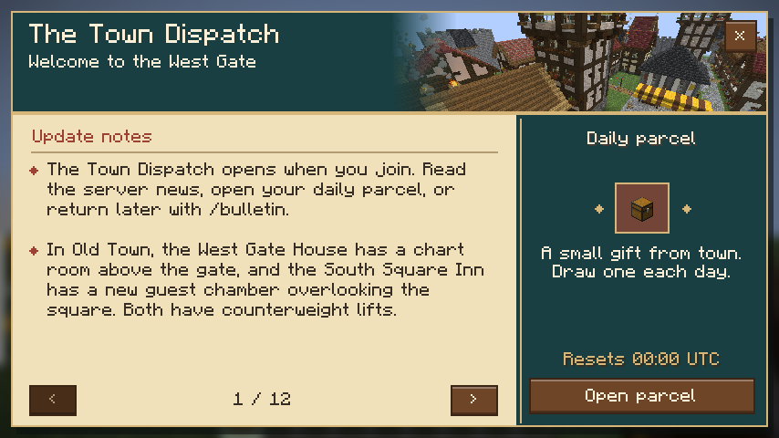

# The Town Dispatch

Joining a dedicated Jugcraft server opens its Town Dispatch after the world loads. Players can turn the news pages, draw a parcel, or dismiss the screen with × or Escape. The news stays open after a draw. Any player can reopen it with `/bulletin`, including in a single-player world. The existing title-menu updater still handles downloading releases.

The masthead uses the server's configured message of the day and a Minecraft screenshot of Old Town's South Square Inn. Public bullets come from the marked section of `distribution/RELEASE-NOTES.md` embedded in the running server build. The server sends the news to the player, so opening the bulletin requires no external service.

## Daily parcels

One optional draw per player on each UTC calendar date. The button shows the odds on hover. Six torches have a 30% chance, two bread 25%, two apples 20%, four cookies 10%, a lantern 10%, and a flower pot 5%. Each roll gives one of these stacks. The server issues the draw and keeps the receipt on the player's saved data across logout and death. If inventory space is short, the same day's roll waits until the whole stack fits. Spectators can read the dispatch. The draw refreshes at midnight UTC, including while the screen is open.

Implemented with OpenAI Codex (GPT-6). The screen reuses Jugcraft's stable buttons and native Minecraft item rendering.

Two focused server tests passed for daily eligibility, clock rollback, separate players and full bags. A rendered Minecraft client joined a disposable dedicated server twice under the same identity. It read the configured MOTD and bundled news, changed pages, dismissed the screen, reopened it with the command, collected a parcel and returned to the collected state after reconnecting.

