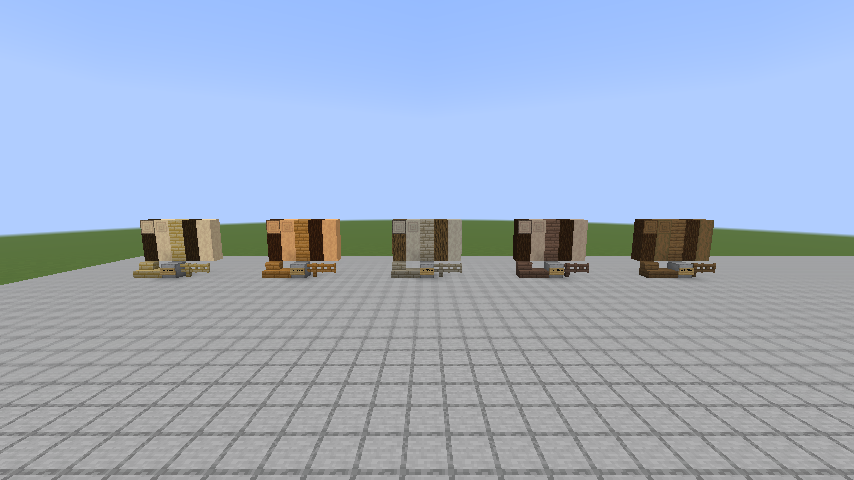

# Trees batch 2: pine approval and warm/mountain tree generation

Status: owner-authorized implementation, 15 October 2026. Public branch `speedygroyper:codex/tree-generation-batch-2`. **The first checkpoint is the pine wood set only. The owner must approve its appearance before any tree shapes, needles, saplings or biome changes are implemented.** Actual tool: OpenAI Codex (GPT-6), directly requested by the owner.

## First checkpoint: pine wood

Match the quality of the existing woods, using the shared nine-block wood family: log, wood, stripped log, stripped wood, planks, stairs, slab, fence and fence gate. Preserve the current log-art convention: Minecraft texture references with Jugcraft tints, never bundled Minecraft images. Compare pine with existing Jugcraft and vanilla woods in an actual inspection world, including end grain, all log axes and a small building example.

The proposed colour is the tree roster's muted warm grey-tan, from owner painting 6, with the existing plank drawing method. Inspect the owner library's pine assets and current woods before selecting the final preview. Sources and any transformations will be recorded below. The initial set has Creative/inspection access and normal processing recipes; natural acquisition waits for the approved tree stage. This is an intentionally incomplete draft, not a survival release.

## Authorized work after pine approval

The owner approved the planning recommendations in this chat:

- Cottonwood: Floodplain 30%, Prairie 10%, Lush River 10%; target 12-18 blocks tall and 11-17 across, using aspen wood and seasonal leaves.
- Japanese maple: Hot Springs 30%; target 4-5 tall and 7-9 across, using seasonal maple.
- Live oak: Subtropics 30%, Bayou 15%; target 6-8 tall and 13-17 across, with sparse existing shroud moss.
- Windswept pine: Shield 25%, Karst Pinnacles 65%, Hot Springs 55%; target 6-9 tall and 7-11 across, with the approved pine wood and new needles/sapling.
- Big jacaranda: Jacaranda Glade and Glimmer Grove 15% each; target 10-14 tall and 9-13 across.
- Mallee: Outback 30%, with desert acacia 70%; target 4-6 tall and 5-7 across, with sand-compatible natural placement.
- Giant eucalyptus: Eucalyptus Forest 8%; target 28-42 tall and 7-9 across with a 2x2 trunk. Full mix: ordinary eucalyptus 47%, big eucalyptus 25%, oak bush 20%, giant 8%. Four eucalyptus saplings grow the giant.
- Preserve existing per-chunk attempt budgets and unrelated tree/fruit selections, including Shield's aspen/larch and Subtropics' citrus. Percentages are shares before placement failures; dimensions are visual targets to measure in generated samples.
- Lush Desert: desert acacia 80%, small palm 20%, plus scattered grass/dirt islands targeting 10-15% visible surface coverage after measurement.
- Flower Isle: apple 15%, oak bush 85%, retaining its separate wild apple patches.
- Existing-tree swaps: cypress 10% in Lavender Field; small palm 10% in Lush Grassland and 15% in Oasis; palm 20% and small palm 20% in Overgrown Beach; replace Mycelial Jungle's ordinary oak with mahogany. Defer Lavender's proposed winter-snow change to the later olive/climate pass.
- Use seeded variation, soil and clearance checks, shared seasons and wood systems. New chunks only; no retrogeneration. The other six variants initially remain natural shapes of existing woods.

Planning reference: [tree roster](../branches/TREES.md). The roster's old current-state table predates batch 1 and its final table includes future batches; neither is to be applied wholesale.

## Validation and delivery

The actual Creative gallery compares pine with vanilla oak, spruce and birch plus Jugcraft cedar, fir, larch, eucalyptus and chestnut. The first wall shows all nine forms, log axes and end grain; a pavilion shows tiled planks, roof stairs, beams, stripped framing, slabs, fences and gates. The client test saves and reopens the gallery, checks 55 placed states and all nine inventory items, and exports it for owner inspection. Screenshots below are from the real client, with the full optional integration set.

Validation on 15 October 2026 (Minecraft 26.3, Loader 0.19.5, Fabric API 0.161.0+26.3, Java 25.0.4.1):

- `./build-local.ps1 -Tasks build`: all **1,646 required server tests passed**, including four pine tests for axe stripping/durability and axes, actual hand recipes, drops/tags/fuel and powered sawmill processing.
- `runClientGameTest -PclientTests=PineWoodClientGameTests`: passed with full integrations, then with `-PjugcraftOptionalIntegrations=false`. Both runs verified save/reopen and inventory; screenshots were visually inspected.
- `python tools/check_mod_data.py`: passed 2,657 material IDs and data/recipe audit; checked 8,374 block/item models, 3,707 quad parts and 171 combined models. `check_icon_maps.py` passed with 27 existing non-pine warnings.
- `python scripts/check_repository.py`, all 34 `scripts/tests` tests, `package_modrinth.py check`, and verification of all 18 locked downloads passed. Generators/tests used the required DejaVu font directory.
- The exported save was copied before cleanup. All 1,554 saved region records and the other save files were scanned; no actual test content was present. Only two development datapack names and five unused test registry names were removed. Every other NBT value and all other saved file bytes were preserved.
- Ordinary `runClient` opened the cleaned gallery with the full integration set and no test mod. The player joined at `(0.5, -60, 5.5)` without missing-content or datapack failures; the client was left open for owner inspection.

The first full-suite run exposed overlapping nuclear test fixtures: the radiation test's large plant and the relay-room test's medium plant both used nearby relative `(5000, 0, -5000)` sites. The failed test passed alone; giving its large plant a separate fixed site made the full suite pass. Only test placement changed, with all nuclear assertions and production code retained.

World files, logs, source commit and exact artifact hashes are delivered with the local preview, outside Git. The pack contains the matching JAR and saved gallery; third-party launcher import, two-client multiplayer and long-duration performance are not claimed. Tree-generation testing and a natural batch-2 world follow only after pine approval.

## Compatibility and provenance

New saved IDs remain registered when acquisition is disabled. No dependency or platform upgrades, release, merge or server deployment are included.

The first preview uses owner painting 6's proposed `#a49a84` warm grey-tan in `tools/wood_style.py`. Pine is appended to the shared palette so every existing wood keeps its seeds and pixels. Planks use the existing four-board layout, short grain, alternating joints and six-tone ramp. The five authored texture files are generated by that shared system.

Before drawing, the owner library catalog and `art/owner-library/originals/Blocks/biomes and tree blocks/` were inspected, including `pine_planks.png`, `pine_log.png`, its cut/stripped variants and the matching door/sign/boat/sapling assets. These were references; their originals are unchanged and no source image was copied into runtime resources. Current cedar, eucalyptus and chestnut planks and the wood comparison sheet were also inspected.

The 11 October owner correction in [Natural Textures](../NATURAL_TEXTURES.md) controls runtime logs: pine references Minecraft oak bark with multiplier `#c9c4b7`, and pale-oak end grain/stripped grain with `#b9b6a4`. These produce darker brown furrows and muted grey-tan cut wood. The client applies the shared tint table to placed blocks, and item models use the same constants. No Minecraft image is bundled. The older authored bark/end textures remain generated for the shared asset contract, but the runtime models use these vanilla references. Doors, boats and other extra forms are not part of the existing nine-block family.
