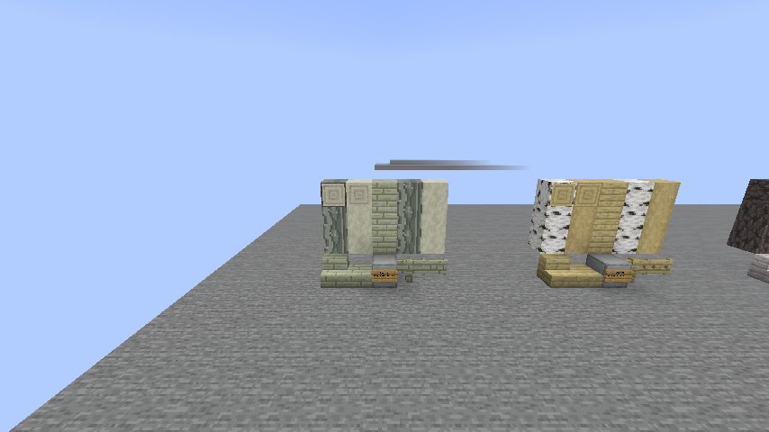
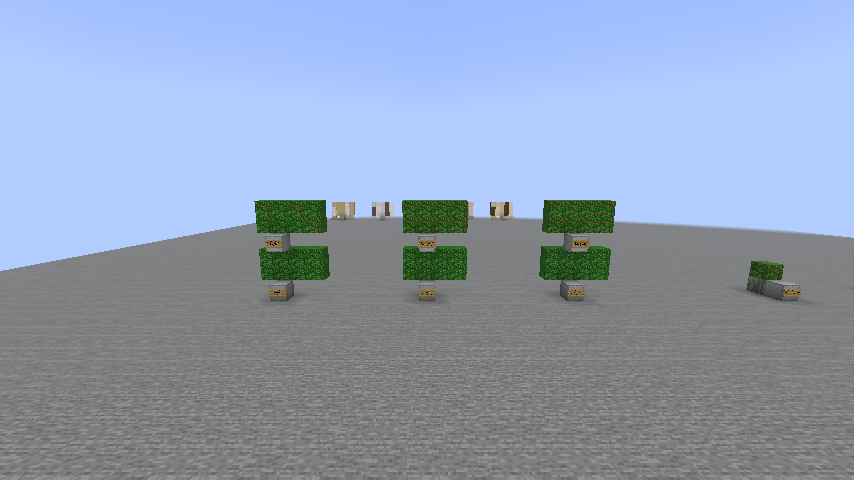
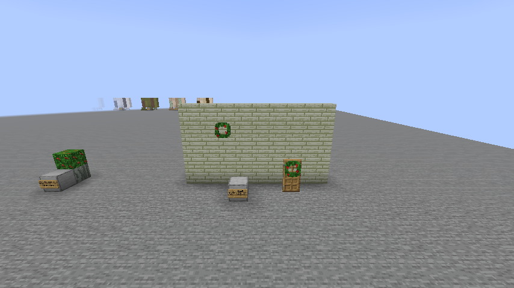
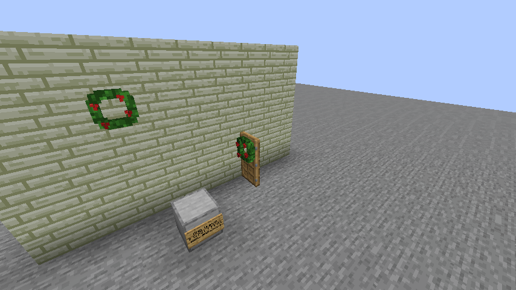
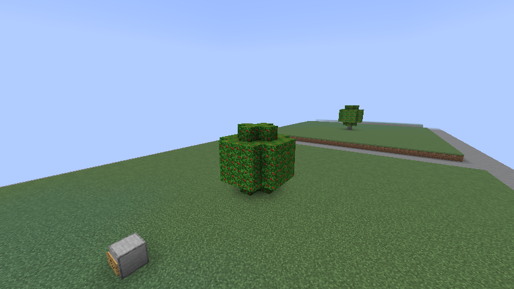
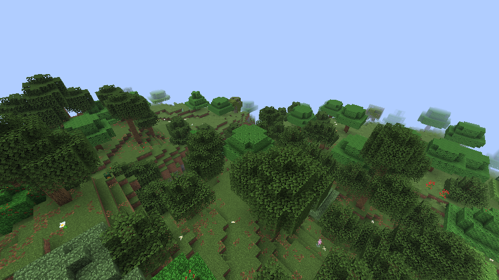
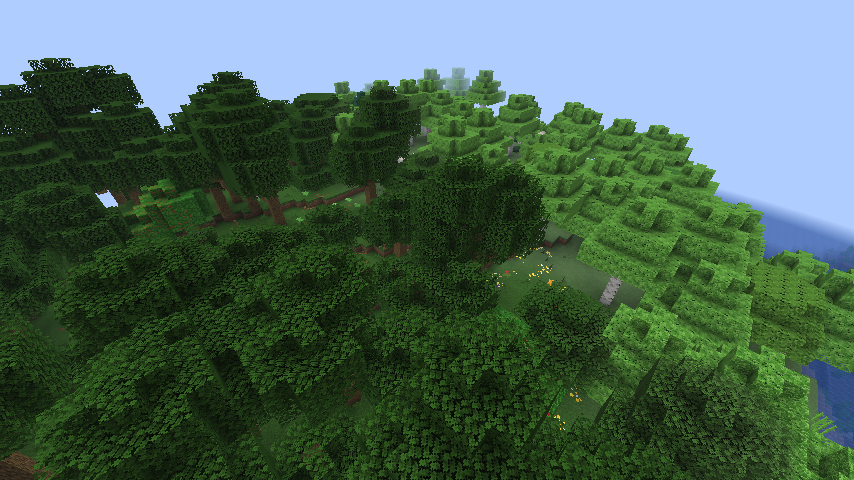

# Tree generation batch 6b: holly

Status: implemented, awaiting owner inspection in [draft PR #404](https://github.com/jimbozoomer-byte/jugcraft/pull/404), 16 October 2026. Public branch: `codex/tree-generation-batch-6b` in `speedygroyper/jugcraft`. Actual tool/model: OpenAI Codex (GPT-6). Based on the approved batch 6 branch (PR #399), already reconciled with main after #398. Batch 7 is excluded.

## Scope

Add a renewable holly tree, its nine-block ivory wood set, glossy evergreen leaves, sapling, decorative holly sprigs and Holly Wreath. Use the existing tree, seasonal foliage, wood, recipe, tree-farm and wall-wreath systems. No new dependency or progression gate.

Woodland receives 4% holly from its ordinary oak default, preserving hawthorn, elder, fallen oaks and the remaining 3.5% oak bushes. Dense Forest receives 5% holly from its roughly 7% oak-bush share, preserving the other trees. Counts remain 9–10 and 14–16 attempts respectively (the upper count in 10% of chunks). Soil and space checks can reject attempts.

The tree uses a straight trunk of four plus zero to two logs and native fancy foliage (radius 2, offset 0, height 4). This produces the intended broadleaf oval; the originally suggested height-four blob would spread too far sideways. Across twelve seeds in each of summer, winter and seasons-off, the measured trees were 5–7 blocks high and 5 wide, with 4–6 logs and 69 leaves. All leaves connected by faces to the trunk, and three distinct height/shape hashes occurred. These are sampled bounds, not worldwide population statistics.

The wood uses the approved grey-green ivory palette `#b6baa1`, smooth grey-green bark, deep glossy green foliage and small scarlet berry clusters. Follow the existing deterministic 16×16 art tools and runtime native wood references where appropriate; preserve previous species and the owner library. The owner-library catalog contains no holly-specific assets.

## Sprigs and seasons

The leaves stay green all year. They reuse the shared seasonal state and [100, 300, 335] schedule for appearance: autumn/winter foliage has scarlet berries, while one in three green-state model choices carries berries, including seasons-off. These berries are decorative, not a new food item.

Right-click supported natural leaves with shears to clip one sprig, damaging the shears once and visibly removing berries from that block. Clipped leaves have a one-in-sixteen regrowth chance on each random tick in every calendar mode; repeated immediate use and player-placed leaves yield nothing. Ordinary shearing/Silk Touch still obtains the leaf block without bonus sprigs. Natural decay and renewable sapling drops remain intact.

Craft one Holly Wreath from eight sprigs around a central string. Reuse the Autumn Wreath's wall/door placement, facing and support-loss behavior, with a dark green ring and scarlet clusters. It is permanent decoration, available year-round; mums do not recolor it. Both wreaths now follow the door panel when it opens or closes, including either hinge and redstone-operated doors. An occupied destination drops the wreath once without replacing the obstruction; the Autumn Wreath keeps its flower colour.

The inspection's flat foliage panels are player-placed decorative leaves and cannot yield sprigs. Use shears on an actual holly tree (including one grown from a sapling) or the marked natural demonstration leaf. An empty hand cannot clip sprigs. The panels are now labelled "Display only".

## Verification and delivery

Passed locally: the full build and all 1,764 required server game tests; all 28 tree Python regression tests; four focused server game tests; repository checks; 826 generated tree/biome/loot/model/recipe-view JSON comparisons; and eleven deterministic texture comparisons. All previously committed texture files are byte-identical. The server tests exercise 36 seeded trees, calendar initialization, leaf connectivity, sapling growth and obstruction protection, all calendar modes of clipping/regrowth, duplicate prevention, placed-leaf restrictions, decay, leaf loot, stripping, crafting/sawmilling/tree farming, wreath crafting, all four wall facings, floor rejection, door placement and exactly one dropped wreath per removed support. The full data/recipe/art audit passed after teaching its plain-item parser to recognize a decorative ingredient registered directly in the building tab: 2,806 material IDs, 8,409 block/item models, 3,707 quad parts and 171 combined models.

The rendered `HollyClientGameTests` passed, saving and reopening all three gallery trees, seasonal/clipped foliage states, and wreaths. Ten screenshots were inspected, including cutout and solid leaves. Two untouched natural samples contained holly: Woodland at -1664, 93, 1728 had 32 holly logs and 523 leaves; Dense Forest at 832, 67, 1744 had 74 logs and 922 leaves. These local samples establish presence, not a measured global frequency.

The `Holly Inspection` world uses seed `jugcraft`. Its authored garden is at 1000, 180, -988; `TOUR.txt` gives the natural stops. Inventory supplies include shears, sprigs, wreaths and saplings. Random ticks are frozen for inspection; restore `minecraft:random_tick_speed` to 3 to observe natural regrowth. A narrowly cleaned copy preserves all 90 save files and every gameplay value, removing only unused development metadata from `level.dat`, `level.dat_old`, and `data/fabric/registry_entries.dat`. The scan covered 6,210 saved region records and found no actual test content. The ordinary Minecraft client opened this cleaned save and joined at 1000.5, 180, -987.5. External launcher import, two-client multiplayer and server deployment are not claimed.

Initial delivery files are `Jugcraft-Tree-Batch-6b.mrpack`, `Tree-Batch-6b-World.zip` and the matching `jugcraft-tree-batch-6b.jar`, with a readable tour, screenshots and SHA-256 checksums. Archive integrity, every saved-world byte, the exact JAR and all 18 pinned dependency entries were verified. Initial gameplay/art source is `00211cb936f9dfe2291cb5ed9e51cedcbc0d046c`; the following commit records the completed full audit only. GitHub's eight client shards and combined client check also passed for that gameplay commit.

### Door attachment and clipping clarification, 16 October

The owner reported trying to harvest the decorative panels and a wreath left floating when its door opened. Sprig acquisition rules are unchanged; the gallery labels and instructions now explain the distinction. Shared wreath support now follows the physical panel after both door halves update. Movement preserves the wreath state, does not overwrite another block and drops exactly once if obstructed.

Only focused checks were run for this correction, as requested: the five holly server tests passed, including actual scheduled movement across 16 combinations of wreath type, door direction and hinge, on both halves, with manual oak-door and powered iron-door opening/closing, obstruction and support-loss checks. The full suite and full data audit were not rerun. The single `HollyClientGameTests` class also passed actual input checks (empty hand refused, shears clipped the natural leaf once, repeat clipping and the display leaf refused), rendered the wreath on the opened door, and saved/reopened the gallery. The open/closed door screenshots were inspected. Its refreshed preview preserves 89 save files, with only the same three development-metadata files cleaned after scanning 6,212 region records. Existing floating wreaths in earlier saves are corrected when the door is operated.

### In-game screenshots

Open PR titles and public branches in upstream and all four listed forks were checked before starting. No separate holly implementation was identified; the upstream tree-roster branch is the existing plan. This is not approval to merge or deploy a server world.

## Compatibility and asset provenance

New chunks gain the trees; existing terrain is not rewritten. Disabling biome generation preserves registered blocks, items and saved decorations. Sprigs and wreaths are optional early-game decoration, with no food, event-only unlock or core progression dependency. No new framework, seasonal state or external dependency is introduced.

`tools/holly_textures.py` extends the existing original pixel-art generators. Wood colour follows the approved nominal recolour of owner painting 10; bark uses the agreed smooth grey-green palette. `tools/wood_style.py` appends the new wood without shifting prior seeds. Bark and planks use the generated holly images; cut and stripped faces reference the player's native pale-oak textures with a fixed ivory tint through the existing wood renderer. No Mojang image is redistributed. The wreath reuses the Autumn Wreath's ring geometry and attachment class while supplying its own foliage and raised berry clusters; the existing wreath retains its original recipes and mum recolouring.
