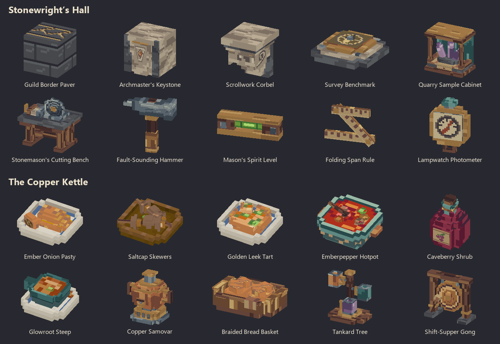

# Western city expansion and Undercity

Local development on `feature/western-city-expansion-nov16`, based on `09f1c933c4be2f92d53aeef4ac7d4f0c1e2cf4a1`. The November 17 waterfront plan supersedes the earlier architectural prototypes below. Live placement requires a fresh site review and separate owner maintenance approval.

## November 17 waterfront, Deepstead and apartments

### Old Town and district residents

#### The new Deepstead shops

Enter Deepstead from the covered passage on the bridge between the two western gates. On the middle ring, head south to the Copper Kettle and look for the copper hearth and hanging kettle. For Stonewright’s Hall, take the stairs down to the lowest ring and follow its northern side to the stone arch and crane yard. Each building has its own counter and resident merchant. Talk to the dwarf to browse and buy with Jugs.

| Dagna at Stonewright’s Hall | Jugs | Bruni at the Copper Kettle | Jugs |
| --- | ---: | --- | ---: |
| Guild Border Pavers ×4 | 2 | Ember Onion Pasties ×2 | 3 |
| Archmaster’s Keystone | 3 | Saltcap Skewers ×3 | 3 |
| Scrollwork Corbel | 4 | Golden Leek Tarts ×2 | 4 |
| Survey Benchmark | 5 | Emberpepper Hotpot | 4 |
| Quarry Sample Cabinet | 7 | Caveberry Shrub | 3 |
| Stonemason’s Cutting Bench | 12 | Glowroot Steep | 4 |
| Fault-Sounding Hammer | 9 | Copper Samovar | 8 |
| Mason’s Spirit Level | 8 | Braided Bread Basket | 4 |
| Folding Span Rule | 7 | Tankard Tree | 5 |
| Lampwatch Photometer | 6 | Shift Supper Gong | 7 |

Dagna carries a brass square. Her four instruments sound for cavities, check a five-block course, measure a span and read the sky and block light on a face. Her cutting bench opens stonecutting. Bruni wears a kitchen towel and carries a long-handled ladle. The shrub clears nausea and Glowroot Steep grants 45 seconds of night vision. The samovar steams when lit and the shift gong rings when struck.

Dagna’s instruments have solid handles, working ends and fittings that show in hand and in frames. Her cabinet holds an amethyst cluster, a copper nodule and a split sky geode. Bruni’s kitchen uses the menu’s lined dishware and the owner’s food palettes for the filled pastry, mushrooms, leeks and berry cordial. The samovar has separate charcoal and ember settings. OpenAI Codex authored this art pass. Running `python tools/deepstead_shop_art.py` rebuilds the model states, material tiles and the six placed servings.

The focused client test displayed the whole catalogue at two test counters and in the player inventory. The stock and food suites passed five tests, the art audit passed all 29 models, and 120 packaged resources matched the source files byte for byte. Local in-game comparisons are in `build/western-city-plan/guild-wares-refined/counter-comparison.png`.

New waterfront surveys include both buildings. In a town with the earlier waterfront already installed, load the two galleries and run `/jugcraft town expansion guildshops` to check the sites. Then run `/jugcraft town expansion guildshops apply`. The upgrade checks 1,208 individual blocks against the installed mine and reports the coordinates of a conflict before making changes. The original waterfront before-image still covers both sites for rollback. Returning to an open shop or running the command twice keeps the same merchant identity.

Three Claude Opus 5.5 reviews covered roof recovery, the workshop and taproom layouts, and merchant transactions. OpenAI Codex implemented the changes locally.

The copied-terrain Minecraft client bought goods from both installed dwarves. A player chest holding diamonds stopped the initial retrofit before any write. After a save and reopen with a mix of old and new blocks, a second chest holding emeralds stopped recovery until the obstruction was cleared. The same two merchants returned and rollback restored all 1,662,582 original block states and the copied container data. The model check rendered all twenty products. Local images are in `build/western-city-plan/guild-shops/deepstead-shops.jpg` and `build/western-city-plan/deepstead-market-goods.png`.

All 27 dedicated-server GameTests passed across the Deepstead, roof, resident, apartment, town routine and western district suites. The stock test purchased all twenty offers, including both merchants’ second pages. The geometry and regional-data suite passed 44 checks. The packaged local JAR matched all 90 checked resources and 41 compiled classes.

A separate fresh-world run also passed. It installed the revised waterfront directly, completed purchases at both counters, reopened the save and restored the initial terrain in full. The edited-roof client run raised all four buildings, including the custom copper dormer and open skylight. Matched street views are in `build/western-city-plan/guild-shops/old-town-comparison.jpg`.

#### Old Town roof upgrades

The West Gate House gains two jettied storeys above its first raised floor, with a chart room and a copper-trimmed hoist. The South Square Inn gains three, with a projecting sign and a furnished guest chamber overlooking the square. Their lifts reach every new floor. Inspect an existing town with `/jugcraft town upperfloors`, then use `/jugcraft town upperfloors apply`. The survey follows edited roofs and checks the widened footprint. [Rooms, roof survey and recovery](old-town-upper-floors.md).

#### Previous civic build

Four properties in the original city gain one storey with their own roof shapes and materials. New towns build those storeys with the original chunks. In an existing town, an operator can run `/jugcraft town upperfloors` to inspect the properties, then `/jugcraft town upperfloors apply` to raise eligible roofs. Each building is checked separately. A changed roof or occupied work area leaves that property available for a later review.

Counterweight Lift blocks act as floor landings. Stack them in the same column, up to 32 blocks between stops. Stand on a landing and use it with an empty hand to go up, or sneak and use it to go down. An obstructed shaft, occupied landing or private destination prevents travel.

The western installation staffs Deepstead with four guild workers, two merchants and three guards. Look for the lampwright and miners' outfitter at the green and red booths in the middle gallery. The lampwright sells a three-setting Geode Reading Lamp for 5 Jugs and tunable, redstone-playable Gallery Chimes for 7. The outfitter sells a Shaft Plummet for 8 Jugs to sound a drop up to 64 blocks, and a Surveyor's Reel for 12 to pin a location and measure offsets. Both sell four Miner's Knot Tiles for 2 Jugs. All three furnishings can be used in rented units.

Two additional human guards cover streets inside the original city. Five patrol the western approaches, exchange and harbour after installation. The three apartment managers carry ledgers and cover Brick, Bell and Timber Courts respectively. Use a manager to browse that building's vacancies and weekly prices. You can rent an upper-floor unit while standing at its own manager's desk. A clicked listing still shows the price before payment. Room ownership, payments and recovery use the existing apartment registry.

The city's saved roster and the waterfront installation token identify residents across unloads and restarts. Rollback withdraws only the residents of that installation. The original city retains its residents, and privately placed NPCs remain outside the district roster.

Three Claude Opus 5.5 design reviews contributed the roofline and lift-clearance checks, the dwarves' silhouette and torchlight art direction, and the building-specific rental ledger and multiplayer cases. Implementation and game tests were prepared locally using OpenAI Codex.

The November 17 civic build passed 26 dedicated-server GameTests across six suites, 35 geometry and region-reader tests, and three rendered Minecraft client scenarios. The copied waterfront opened all 72 rooms, spawned all 17 western residents, accepted a paid upper-floor lease at the matching desk and rejected the same transaction at another court. Removing the installation withdrew its staff and restored all 1,662,582 blocks and the original container data. A separate legacy-town client world received all four eligible rooftop upgrades. A server fixture with an edited roof confirmed that the upgrade leaves it alone. The dwarf client exercised the three role meshes and both visor positions. The city tests and the two merchant-price checks passed. Two pre-existing global essence-conversion audit checks still fail on routes outside these shops.

The in-game comparison sheets are `build/western-city-plan/civic-views/old-town-comparison.jpg` and `build/western-city-plan/civic-views/dwarves-of-deepstead.jpg`. The final screenshot run checked all four facades from matched street views and recorded the three dwarf roles under forge lighting. The local playtest JAR was checked against the compiled classes and the resources used by the game tests.

The subsequent Deepstead appearance revision follows the owner's forge-worker and helmet references. The smith has a shaved crest, a forked beard, steel-toed boots and a stone maul. Merchants wear a folded cap and twin plaits, and carry a stamped ledger. The lampwright's bag carries a geode sample and the outfitter's carries a rolled map. The watch wears dark plate, bronze cheek hinges, chain sleeves and an oxblood split tabard. The separate visor pivots over the nose. The shared native rig and all three double-density skins come from `tools/deepstead_dwarves.py`. OpenAI Codex authored the revision against the existing saved role and appearance IDs.

The focused Minecraft client test checked all three beards on the shared renderer and both guard visor positions. Close-ups exposed a nose clipping through the lowered grille during development. The final hinge and plate passed the focused rerun and the nose clears the front by 0.29 model pixels. The resulting in-game portrait sheet and matched comparison are in `build/western-city-plan/dwarf-refinement/portraits.jpg` and `before-and-after.jpg` in the same directory.

Leaving the original city by its west gate, the covered opening on the right side of the bridge leads underground. Deepstead lies beneath the original city. Its galleries sit 54, 68 and 82 blocks below the city floor. Stairs connect the three circuits, nine workshop interiors, a copper-trimmed watchtower, a market and a glazed waterworks. The approach starts on the new bridge to spare the occupied streets above.

Crossing the bridge leads to three apartment courts, with a brick eight-storey house, a white seven-storey house with a bell gable and a six-storey timber-and-mud-brick house with a rooftop pergola. There are 72 private interiors. The older 48 room IDs keep their original doors. The public stairs also go to the roof gardens. Continue through the second ring's west gate to reach the harbour. Three piers serve small boats and two moored, boardable scenery vessels. The quayside includes a cartographer, chandlery, smokehouse, inn, striped fish market, cargo derrick, lighthouse and customs belfry.

### Renting and furnishing

- Use `/apartment list` to browse eight units at a time, nearest first. Choose Next or Previous, or enter `/apartment list <page>` directly. Your own lease stays visible. Sneak and use a unit door empty-handed to inspect it in person. Check the room, price and location with `/apartment info <room>`. At the property, `/apartment rent <room>` buys seven real days for 8 or 12 Jugs depending on its size. Renewal is explicit with `/apartment renew <room>`.
- Tenants can place supported single-block furniture such as chairs, tables, carpets, lamps and a private barrel in free interior space, then collect their own pieces. Structural blocks, furnished fixtures, door thresholds, corridors, stairs and adjacent units stay protected. Pack up before using `/apartment leave <room>`.
- Operators use `/apartment tool` to select the two opposite corners of an interior with left and right click. For interior air corners, stand in the desired cell and use `/apartment pos1` or `/apartment pos2`. Publish it with `/apartment define <name> <weeklyJugs>`. `/apartment remove <name>` removes a vacant, cleared custom listing.
- If a lease expires with belongings inside, staff can use `/apartment packout <room>` while its chunks are loaded. This reopens the room and keeps the furniture and stored items for their former owner. The former tenant can return to the property and use `/apartment reclaim`, then make space and repeat if their inventory fills.

### Placing the local design

The operator entry point is `/jugcraft town expansion survey waterfront`. Work from the saved Overworld town origin with the shoreline at the designed elevation. The older bare `survey` command selects the flat prototype. For the waterfront, the operator must keep the affected chunks and their buffer loaded. The survey never force-loads chunks. Wildlife, player builds, protected land and changed terrain can stop a job. Review the entire site and the returned token before `/jugcraft town expansion apply <token>`. Check progress with `/jugcraft town expansion`. The same token supports pause/resume and rollback as described below. Withdrawn listings release only when tenants and belongings are accounted for.

Generate the waterfront asset with `python tools/western_city_waterfront.py`. The combined plan uses the saved town origin. Its outer walls, buildings, mine and port occupy 1,662,582 authored cells. The previous flat prototype remains available for its existing journal. The optional copied terrain under `build/western-city-plan/live-reference/` is a planning snapshot, not a current production backup.

### Copied-world acceptance

All 32 geometry and region-reader checks passed. They cover walking routes to all 72 interiors and roof landings, the three mine circuits and the shoreline piers. The terrain audit found no overwritten block entities and no exposed fluid face along the excavation. The rendered Minecraft test ran the actual survey, apply and rollback commands on a disposable copy of the region files. After fluid ticks the mine stayed dry, all 72 listings opened, and existing container data, including the shipwreck chest, matched the original. After rollback and another 120 ticks, every one of the 1,662,582 surveyed block states and every recorded container payload matched again. The rollback restores terrain bottom-up so sand and gravel keep their original positions. The seven in-game views are under `build/western-city-plan/nov17-views/`; the command run is recorded in `nov17-client.log` alongside that folder.

Five western district server GameTests and six apartment server GameTests also passed. They exercised public workstation menus, the room catalog, rent payments, owner designation, cross-room protection, expired leases and recovery of a former tenant's furniture and private storage. The final local JAR contains the tested waterfront, apartment classes and save mixin. The pack's full regression suite and the present live site's survey remain outside this local validation.

Claude Opus 5.5 contributed the facade and roof design review, including the cornice, shuttered window arches, terrace framing and stair clearances. OpenAI Codex (GPT-6 family) implemented the gameplay, authored the voxel layouts and integrated the tests.

## November 17 revision — a second walled quarter

The owner's revised layout keeps the original city inside its own curtain and puts a separate fortified quarter west of its gate. The old west gate faces the new east gate across roughly 50 blocks of open terrain. A stone bridge carries a five-block-wide lane across the ravine. The western gate opens toward the waterfront.

The new perimeter follows sixteen bends around the three terraced courts. It uses the original town's masonry, nine-block-high wall walk, fourteen round towers and two twin-tower gatehouses. The western buildings and their 48 room identities fit inside this ring. The hillside between the districts remains open on both sides of the bridge. The two approaches meet at the existing city's road. The earlier three-sided flat prototype is still a development fixture for the dry-site installer.

A first foundation survey intersected farmland and a buried structure. The revised north curtain runs inland of both. Geometry tests check those volumes, the walking route to all 48 rooms, both undercity approaches, the full width of the gate passages and the closure of the perimeter when both gates are capped. The copied-world material comparison covers every affected chunk and reports zero directly replaced block entities. The revised candidate has 1,310,124 authored cells. The independent water-boundary comparison reports zero exposed fluid faces.

All 20 geometry and region checks passed. The complete rendered copied-world test passed in 5m03s, including the scheduled fluid ticks, dry undercity and unchanged copied-container payloads. The two-ring aerial and bridge profile were visually reviewed. The final screenshots are in `build/western-city-plan/walled-ring-render/` and the run log is `walled-ring-final.log`. The local comparison map is at `build/western-city-plan/western-ring-layout.png`. This revision updates the architectural candidate. The live-terrain installer, current-save revalidation and district patrol work are tracked separately. Implemented with OpenAI Codex (GPT-6.2 Astra).

## Owner direction

Build the expanded city first, then add each selected money sink individually and fit its premises into the prepared district. Enlarge and heighten apartment buildings; add an Undercity-inspired underground district; expand west through the existing west gate; blend the surrounding terrain into the new city. Preserve owner and player additions, especially the church slot machines.

Approved ideas from the 25-item list: 1 furniture showroom; 3 apartment rentals; 4 market-stall leases; 5 auction fees; 6 postal service; 10 equipment refurbishment; 11 decorative building kits; 12 town improvement projects; 13 statues/portraits; 14 horse tack; 15 stable services; 16 pet cosmetics; 17 tailor/wardrobe; 25 prestige purchases. Ideas 8 public workshops and 9 commissioned manufacturing require further design. Other ideas were not selected for this phase.

Normal apple/cocoa farming income is owner-accepted. Use purchases players want, not penalties for recovery or basic travel, to remove Jugs from circulation. Payments must actually leave the spendable economy; transfers to another player are not themselves a sink. No final prices are set by this plan.

## Existing implementation constraints

- `tools/town.py` generates a 192 by 192 local footprint, with the east-west street at local Z94-98. Town origin and centre are saved identities; do not recenter them when extending west.
- The last inspected live saved origin is X1296/Z400. Refresh the live world snapshot before placement; do not treat the saved coordinate as proof the western site is unoccupied.
- `TownUpgrades.applyChunk` rejects changes to the old blueprint size. Its authored-state comparison preserves differing blocks but cannot recognize an owner edit identical to the old authored state. An expansion needs its own bounded migration rather than increasing `TownData.size` or rerunning `TownBuilder` over existing chunks.
- `Town.PROTECT_BELOW` is 12. The underground district will extend deeper; add protection for its actual active three-dimensional bounds rather than protecting every cave under the whole town.
- The east Styx district is a useful example of an additive footprint, but its original terrain-clearing placement is not a safe installer for an already populated western site. Do not copy that behavior into a live upgrade.
- Reuse the shared town voxel/building helpers, registry-backed block palette, existing guard/routine and public-interaction systems. Do not create a second world-generation preset or a global active-design singleton. World Designer's new-world terrain export is not a live terrain repair tool.

## Proposed surface layout

Initial planning envelope: town-local X-192 to -16, Z16 to 176, with a connector eastward to the existing west gate. This is approximately another city quarter comparable to the old footprint, subject to an actual terrain/build survey. Negative local X means west; world X0 is irrelevant.

1. **West Gate Avenue:** a continuous, readable route from the old main street through the existing gate into a new civic square. Widen the new portion to seven walkable blocks with sidewalks. Retain the old gate as an internal landmark; do not remove its towers merely because the city grows beyond it.
2. **Apartment courts:** three distinct five-storey buildings, each with a ground-floor public lobby/shop frontage and four residential storeys. Four useful rooms per residential floor gives an initial target of 48 rooms. Use roomier corner units and balcony variants, real stairs and landings, daylight windows and shared courtyards. Avoid identical stacked shoeboxes. Final dimensions follow model/walkthrough review, not this target alone.
3. **Market street and exchange:** reserve premises for the furniture showroom, decorative-kit display, rentable stalls, auction hall and postal counter near the avenue. Complete their architectural shells before their economies, with no fake functioning service signs.
4. **Stable courtyard:** a wider southern lane and paddock, accessible to Shires, Giant Finnhorses and Pegasus cargo. Fit door/head clearance to actual entity dimensions. Keep horses out of tiny pedestrian stairways.
5. **Artisan frontage:** smithy/refurbishment shop, tailor, portrait/statue studio and a prestige showroom. Use varied roof lines, workshops with visible contents, sheltered shop fronts and shared materials from the existing city.
6. **New western perimeter:** a proper gate, lighting and guard circulation, joined to the original perimeter. Rebase raid approach destinations and guard lookouts for the expanded city so they do not attack an obsolete inner wall.

Existing apartment enlargement is a separate plot-by-plot retrofit: compare the authored baseline with live blocks and entities, retain room/NPC identities, and defer any conflicting building instead of clearing it. New western rooms supply capacity even if a retrofit is blocked by an owner's build.

## Proposed underground layout

Build the first underground area below the western addition, not underneath uninspected old houses or the church. Use an original Jugcraft design inspired by a layered underground city: vaulted masonry, a memorable central rotunda, balconies, bridges, service canals and warm shop fronts against restrained green/teal utility lighting. It should be atmospheric and inhabited, not an unreadable maze or a literal copy of another game's city.

- **Upper gallery:** approximately 12 blocks below street level, overlooking the rotunda. Connect this to two separated stair entrances; reserve lift shafts but do not require a future lift mod to navigate the district.
- **Main floor:** approximately 24 blocks below street level. A continuous ring promenade connects the underground bazaar, artisan bays, reserved public-workshop/manufacturing halls and storage/postal service spaces.
- **Readable routes:** visible central landmark, short sight lines to exits, consistent directional signs, railings at drops and bridges across decorative canals. No forced swimming or jumping on an ordinary service route.
- **Usable buildings:** actual rooms and stock/display areas behind storefronts. Provide back-of-house access and reserve machine footprints, noise separation and proper power connections for the later workshop feature.
- **Safe excavation:** inspect the entire excavation volume and its buffer for builds, containers, block entities, claims, protected regions, fluids, entities and existing structures. Never decide that stone or dirt is unowned simply from its block type. Existing caves can be incorporated deliberately after review; they are not automatically safe to fill.

## Terrain and installation contract

Survey first, then produce an explicit per-cell before/after plan. Keep a recoverable snapshot and a human-readable map of all cut/fill, excavation, buildings, road work and protection changes. The initial terrain proposal uses terraces, retaining walls, planted banks and gradual road grades; it must fit actual local ground and water rather than burying a river or raising a rectangular platform on stilts.

The installer must be opt-in and scoped to the saved town origin and a specific plan version. Validate the plan against the current save immediately before execution. Any unexpected block, container, protected parcel or occupied work area causes the relevant coherent section to defer with a report. Do not partially demolish a building around a preserved chest. Journal bounded work and resume safely after restart; reapplying the same plan is a no-op. Rollback must also preserve changes players made after installation.

Room IDs, service plots, entrances and public circulation are reserved in the layout before rental/commerce code. Owner-built machines and containers remain private; ordinary doors, trapdoors, seating, signs and intended service controls remain usable. Future tenant permissions must distinguish a rented room's storage from its publicly accessible corridor.

## Delivery order and acceptance

1. Survey the existing western gate, ground, underground volumes, player/owner parcels and old apartment candidates. Freeze a before-state and proposed district plan. Do not modify the live world at this stage.
2. Implement the expansion migration, district state/protection and conservative terrain connections, retaining the old city's saved coordinates and blueprint.
3. Build and refine avenue/perimeter, apartment courts, undercity, stairs and service shells. Use existing decorative blocks where appropriate; readable silhouettes, detail at player scale and room variation are required.
4. Test installation, partial-progress restart, repeated apply, changed-plan refusal, owner/player preservation, storage protection, public interactions, NPC/guard paths and raid access. Validate doors/stairs/headroom and examine surface/underground builds in the actual client, including low light and normal travel distance. Owner playtest remains owner-controlled.
5. Begin the selected services individually: rentals; furniture; building kits; market stalls; auctions; post; repairs; horse tack; stable services; pet cosmetics; tailor; statues/portraits; prestige; civic projects. Each must work end-to-end before the next is advertised as implemented.
6. Only after their separate design review, add public workshops and commissioned manufacturing with server-authoritative escrow, ingredient ownership, cancellation, queue limits, restart persistence and safe delivery.

Live installation still requires a fresh backup and the owner's separate restart confirmation, followed by the full 30-second in-game warning. The previous release task remains separate; this plan does not mark its PRs merged or its deployment complete.

## Current evidence and remaining work

### Local implementation

- `tools/western_city.py` generates a separate registry-backed blueprint: three five-storey apartment buildings with 48 furnished rooms and stable room IDs; six service shells; covered market stalls; a western avenue/perimeter; two stair pavilions; a vaulted rotunda, upper gallery, bridge and two lower service halls. Furniture reuses the existing crafted oak table/chair. No new textures or external art were imported.
- The original `town.json.gz`, saved origin, existing resident indices and old church remain untouched. Positive local X contains only a five-wide road-surface connection, which still requires the same before-state checks as every other cell.
- `WesternDistrict` provides owner-level `/jugcraft town expansion` status, `survey`, `apply <survey token>`, `pause`, `resume <survey token>` and `rollback <survey token>`. No startup hook installs or resumes anything. All modified cells require loaded chunks; commands do not force-load a world.
- Survey refuses occupied space, containers/block entities (including its buffer), claims/operator protection, non-terrain edits, fluids and unsuitable perimeter heights. Completed surveys write a durable before-image and a unique approval token. Apply revalidates the entire set before mutation. Work is bounded per tick and journals progress; resumed operations revisit every before/after cell to tolerate chunk saves lagging a cursor. Rollback compares actual/before/after states and pauses on later edits instead of deleting them. It is a resumable installation, **not a whole-city atomic transaction**.
- Protection follows the actual authored three-dimensional cells, with four blocks of headroom only over the old-gate connector. Unmodified vertical gaps between the surface and underground structures remain outside protection; neither a broad rectangle nor a per-column depth envelope is used. It reuses existing town public-door, seating and private-container rules. Rollback removes that additional protection once restoration finishes. If a later build changes the plan hash, the recorded original envelope remains protected until its matching build is restored; operations refuse the mismatching journal.
- A changed blueprint hash refuses an old journal. Keep the original matching build available until an installation is complete or rolled back; cross-version journal migration is not implemented. Changes identical to an authored state cannot be distinguished from it. Block-type checks never substitute for ownership review.

### Site evidence — November 16

Read-only copies of `r.2.0.mca` and `r.2.1.mca` were downloaded from the current server file panel. The server remained online, so these are **planning references, not a transactionally consistent backup**. The report, region hashes and terrain map are local under `build/western-city-plan/`; no world data is committed. `tools/western_city_survey.py` reads copied regions and writes a separate report.

The western basin is roughly 50 blocks below the old gate, with significant water and existing block entities/structures. A fresh `town.dat` confirms origin **1296, 114, 400**. A current `land.dat` reference was also downloaded; the broader survey includes a claim at chunk 73/38, south of the initial district, which must remain outside any terrain expansion. Runtime checks still re-read actual claims and operator protection. The older October 23 reference also had machines there; its occupancy cannot be assumed current. The current flat prototype would produce a giant elevated platform and is deliberately refused by its perimeter-height checks. Fit a descending terraced/waterfront layout and inspect all affected builds, claims and entities before proposing any live operation. The owner was offered terraces versus maintaining the old elevation with massive retaining walls; terraces are the recommended default. Do not remove the checks to make the unsuitable prototype install.

### Terrain-informed architectural alternative

`tools/western_city_terraces.py` now builds a separate review layout with courts at world Y66, Y84 and Y102 relative to the current saved origin Y114. A continuous stair avenue connects these courts to the original gate. The same 48 stable room identities are retained; six premises are redistributed among the courts, with the lower western promenade facing the water. The undercity is lowered beneath the quay and has two normal stair entrances, its rotunda/gallery and both service wings. The wings were moved north beneath the apartment courts to avoid the existing mine. The first stair pavilion shifted east ten blocks; its lower connecting tunnels and the southern entrance are connected to the relocated west hall. The raised courts use spaced masonry supports rather than solid fill through every cave. Forty-five pier bottoms were deepened to the lowest solid surface found across their nine-block footprints in the reference (deepest world Y20). These design elevations still require a current survey before installation.

The recorded surface chest and a surrounding ground pocket are omitted from the authored cells. The known archaeology pocket and southern underground spawner also have three-dimensional exclusion volumes. These exclusions **do not prove the whole site is unowned or safe**: a fresh, consistent survey must find all non-terrain blocks, structures, entities and land rights before any live placement. Retaining walls, seabed support and water isolation still require site acceptance. The initial candidate-versus-reference material audit (`tools/western_city_impact.py`) found existing stairs, a door, torches and cobblestone in the planned works. After moving both service wings, shifting a stair entrance and two supports, and removing blanket subterranean fill, the refreshed audit reports **49 affected block types, zero missing referenced chunks, zero directly replaced block entities, and no affected stair/door/torch/cobblestone/plank/brick/glass/fence types**. The 30 old stair blocks near X-161/Z91 and the door near X-33/Z100 are outside the revised architecture. This is a block-type comparison against running-server copies, not ownership approval or proof of current-state/entire-tunnel preservation. A fresh survey must still inspect connected air spaces, entities, state/NBT changes and all neighboring builds.

This alternative is serialized to `build/western-city-plan/terraced-review.json.gz` and a **test-only** fixture. It is not the production installation blueprint and no live command accepts it. Its rendered test creates a disposable flat world, directly places the authored review geometry and a synthetic stand-in for the chest, and takes screenshots. An optional `JUGCRAFT_WESTERN_TERRAIN_REFERENCE` path also copies only the two reference region files into a newly created, closed test-owned world, then opens that disposable copy and places the candidate there. It never opens the source directory as a save or writes to it. That reference test verifies copied containers' saved contents remain identical. Neither review path exercises the terraced variant's migration/recovery; source copies exclude entity regions, claims and live town data, and are not a complete server clone. The flat prototype remains the installation/recovery test fixture and deliberately refuses the actual live basin.

### Aquifer and dry-space correction

The reference water-boundary audit (`tools/western_city_water.py`) found 39,056 planned dry-space cells currently containing water and 41 direct water ingress faces around roof edges/abandoned passage ends. These would be hidden by a flat test world. The terraced candidate now has an additional 181 masonry boundary cells and builds its structural shell before clearing its dry volume. A geometry regression requires every underground air cell below the quay to have authored neighbors; the same reference audit now reports zero direct open water faces and zero missing chunks. The material audit remains 49 affected types with no directly replaced containers or the identified mine fixtures. These are bounded planning checks, not proof against all waterlogged/porous blocks, transient fluid behavior or ownership conflicts.

The rendered test now also schedules adjacent existing fluid ticks and checks every planned underground air cell for flooding after the screenshot walkthrough. The sealed copied-terrain run passed (`terraced-sealed-site.log`, 4m04s): every planned underground air cell remained dry after scheduled boundary-fluid ticks and the complete walkthrough, the fountain stayed contained, and copied container payloads were unchanged. The reference source-file SHA-256 hashes remained identical to the original read-only report. The final overview, middle apartment facade, stair avenue, gallery and service hall were visually inspected. Screenshots are retained locally under `build/western-city-plan/sealed-site-render/screenshots/`. The production installer is still the flat, dry-site prototype and rejects this basin.

### Validation status

- Eighteen Python checks pass across the flat and terraced blueprints and region reader: all 48 room entrances reached by normal walking, both underground routes and gallery, all three terrace courts from the old-gate connector, complete beds, no old-city excavation, the known-site exclusion pockets, supported lanterns, stable paving beneath authored fixtures, supported 26.3 palettes and corrupt-region refusal without modifying the copy.
- All four focused headless tests passed on the final authored-cell protection implementation (`server-protection-reviewed.log`, 2m37s), including an unmodified vertical-gap regression. They cover actual registry resolution, journal reopen/origin/version rejection, three-way owner-edit preservation and bounded underground protection. Common/client/test compilation passed. The final headless rerun also passed after the rollback-resume status correction and room/light refinements (`server-reviewed.log`, 3m02s).
- `client-acceptance.log` records a complete passing rendered lifecycle: survey; a new chest refused before any writes; partial installation paused; save/close/reopen with no automatic resume; explicit resume and completed installation; repeated apply as a no-op; public door/deeper-protection assertions; rollback pausing specifically at the later owner chest; restoration of every cell to the before-image; and another reopening retaining the completed rollback. It passed in 8m11s. These are automated disposable-world checks, not a personal or live-server playtest.
- Initial tests exposed missing registry IDs, grass-tag assumptions, routine guards occupying the fixture and natural grass decay beneath authored paving. Those were fixed; the occupant protection was retained and its error now identifies the occupant. The test records old residents as unloaded instead of allowing routine care to spawn them into the construction area.
- Render review led to arched alcoves, counters/seats, central promenades, ceiling beams/lights, glazed stair pavilions with supported roofs, gallery lantern braces and better room lighting. Unsupported shop/hall lamps found during review are now attached by chains. Review distance is eight chunks in the disposable client; rendering waits for available chunks rather than an impossible full-square download beyond circular tracking. The final flat lifecycle and first terraced visual review both passed together (`client-reviewed.log`, 9m07s). The flat apartment exterior/interior, stair entrance and underground rooms were visually inspected. The rerouted terraced visual run passed in 4m05s. Courtyard trees/planters, seating, a contained fountain, three covered market pitches, slope flowerbeds and closer street lighting reuse existing town builders. The furnished review passed in 4m01s, including fountain containment; its overview, courtyard, apartment room, rotunda and market were visually inspected. The first copied-terrain review also passed in 4m19s with unchanged copied-container payloads, and its overview/rotunda were inspected. This first review predates the subsequently passing closed-shell run recorded above.
- Repository structure/documentation-link checks and `git diff --check` passed. The final architecture regression suite has 18 passing Python cases; the closed-shell test was added after the aquifer audit.
- Tests use compiled development classes and the complete processed resource directory. The generated source/processed blueprint copies are identical. Incremental reruns skip only unchanged bulk resource copying and unrelated JAR packaging; no distributable artifact is claimed for this branch.
- No live placement, human playtest, forced-process-crash test, or new district guard/raid-route acceptance is claimed. Graceful partial-install save/reopen has been exercised as described above.

### Still required

Fresh live-site water/seabed/retaining-wall and ownership/structure review, including connected mine air spaces; acceptance of the terraced architecture; a terraced installation plan with explicit water isolation and matching recovery validation; new perimeter guard/raid routes; existing-apartment retrofits where safe; full local acceptance before proposing publication. The flat prototype's complete save/reopen recovery validation has passed, but it is not acceptance of a different terraced migration. Rental/shop/auction/mail/payment systems remain separate later features in the approved order. Empty service shells are not functioning businesses.

### Next implementation boundary

This checkpoint completes the local architecture/review chunk, not the live expansion. Do not publish the current `WesternDistrict` prototype as a supported installer for this site: it still contains the flat resource and deliberately rejects the basin. The next implementation must serialize the selected terraced layout for production, provide a recoverable operation over wet terrain with current-state revalidation and preserved exclusion pockets, and validate partial-progress reopening/rollback with fluids. Its site checks must account for the actual three-dimensional footprint rather than refusing every preserved block entity somewhere in the bounding rectangle. Then connect new guards/patrols and raid approaches to the installed district's saved geometry. Existing occupied-building retrofits remain separately surveyed; new rooms do not imply old apartments have been rebuilt. Only after those parts pass should this be packaged and proposed for live maintenance. No tenant payments or advertised shop services are enabled by this architectural checkpoint.
