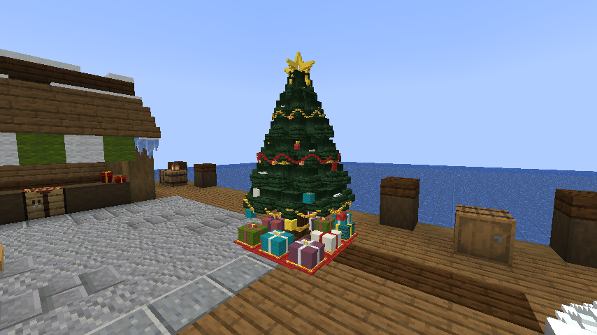

# Christmas at West Gate Harbour

From the city gate, look between two tall peppermint hooks and down an open aisle to the water. A baker works across from the wrapping counter. The big fir stands to one side of the quay so players wrapping gifts can see the boats. A separate pair of furniture kits lets players furnish their own Icelandic hot spring.

## First local collection

| Piece | What a player can do |
| --- | --- |
| Main Square Christmas Fir | Find the 31-block tree on the original spawn-city market plinth after the Harvest Feast. Eight tiers of spruce carry red and gold ornaments beneath a lit star. Its eight gift piles hold sixteen public gifts in total. Crouch and use to give a stack, or use a pile empty-handed to collect. |
| Harbour Gift Fir | Place one tree item on a solid footing with a clear 3×3 footprint and five blocks of headroom. Crouch and use a stack on the skirt to wrap the entire stack. Empty-hand use collects a parcel. There are eight piles with two parcels each. Click a particular pile to choose it or use the trunk to distribute or collect automatically. The tree is a **public gift exchange**. Use an existing recipient-locked present if the contents are for one person. |
| Peppermint Lane Lamp and Boulevard Lamp | Set a 3-block lamp beside a stall or a 5-block lamp at an entrance. Turn the hook inwards to light the path. Both have an iron foot, a solid peppermint crook, a hanging lantern and a switchable light. Leave room at the side for the hook. |
| Wind-Carved Snowdrift and Shovelled Snow Pile | Craft two drifts from two snowballs, or two piles from three. Place a low tapered drift across the wind or tuck the taller shoveled heap against a kerb. The collision surface follows the visible snow. Both stay in place as decorations across seasons. |
| Eave Icicle Fringe | Ice and a snowball make four fringes. Hang them under a supporting beam. Five solid, offset ice teeth of different lengths join a common frozen lip. |
| Hot Spring Changing Kit | Open the kit for a slatted sitting bench, a wool-lined peg rail and a boot tray. A second bench beside the first extends the seating. |
| Hot Spring Pool Kit | Open for a gated stone overflow spout, a wooden dipper pail and a pool lantern. Put a water source immediately behind the spout, then use the gate to show the running stream. |

The **23×22** quay has three timber stalls and a five-block promenade between the peppermint lamps. Inga tends the green wrapping booth, Oskar serves the red bakehouse and Marta runs the blue toy stall. Each has a north-facing water view from the promenade, with wreaths, icicle eaves, string lights and different goods on display. Use a keeper or their counter. All three counters have survival recipes and work away from the quay.

Hold the stack you want to give, open the wrapping counter and pick someone from the address book. **Wrap & post** puts the whole stack in their private inbox. **Wrap & carry** gives you a labelled parcel for hand delivery or placement under either gift fir. Only the named recipient can open it. They can also collect at any wrapping counter if the parcel goes missing. Collecting by either route redeems it once. Player names enter the address book when they join and stay available while offline. Custom names, book pages and item components travel with the original stack.

Oskar sells three gingerbread cookies for 1 Jug, two apple cider doughnuts for 1 Jug or a mulled cider for 2 Jugs. Marta sells a spinning top for 2 Jugs, a turkey pull toy for 3 and a Mayflower model for 5. Gift wrapping and collection are free.

An operator can place the market once on a surveyed empty site with `/place template jugcraft:holiday/west_gate_winter_market ~ ~ ~`. The origin is the northwest deck corner at paving height with water to the north. Allow nine blocks vertically. Placement writes the authored blocks and spawns the three keepers. The live quay needs a site survey before installation.

## Christmas build list

Each row is a separate art batch. Review a dressed corner at player height before moving on. Items in this table are proposed work beyond the first collection.

| Batch | Pieces | How the set fits together |
| --- | --- | --- |
| **1. Market traders** | Hot-cider urn with a brass tap, spice-bun display, gingerbread bakery sign, wool-canopied toy stall, hinged gift counter hatch, striped wrapping-paper rack, twine dispenser | Give each booth one silhouette visible from across the lane. Place working props within reach of a customer and leave vendor access at the side. |
| **2. Gift exchange** | Addressable gift label, wrapping station for signed books, staffed collection counter, two-deck parcel handcart, numbered parcel cubbies, handbell for collecting a delivery | Use the public tree for gifts anyone can open. Build private delivery around the existing recipient-locked presents. A sender needs to know exactly when the recipient can collect. |
| **3. Evergreens** | Broad noble fir in a town-square planter, narrow apartment tree in a stoneware pot, tabletop carved tree, trestle tree-sale rack, wicker tree collar, cranberry-bead chain, glass harbour-boat ornament | Give each tree a different profile. Reuse the existing stackable sections, coloured baubles and tree lights wherever they fit. Leave player room beneath outdoor branches. |
| **4. Light at the water** | Bell-and-star entrance arch, heavy timber messenger posts for sagging light strings, gabled lantern shelter, coloured-glass window star, floating mooring lantern, hanging brass carillon | Use existing Holidayworks bulbs and garlands. See a lantern through the arch and open water between the posts. Keep the wrapping counter brighter than the far pier. |
| **5. Dining room and hearth** | Carved spruce settle with a quilt, red table runner with drooping ends, tiled stove surround, mantel with stocking pegs, three-tier candle pyramid, mulled-drink tray, carved toy chest, sleigh bed with a patchwork quilt | Mix furniture a player can sit on or use with pieces small enough to put on existing tables. Give runners an end section so a long table reads as one piece. |
| **6. Big street pieces** | Passenger sleigh with a folded lap blanket, reindeer harness stand, carved carousel stag, clockwork nutcracker at the gate, walk-through gingerbread arch, postbox shaped like a snowbound cottage | Group by use. Keep a clear boarding side for the sleigh and an actual passage under the arch. Check outlines against buildings in silhouette. |
| **7. Snowbound harbour** | Snow-capped bollard sleeve, snow ridge for a gable, frozen gutter elbow, plough blade leaning on a shed, boot tracks at a shop threshold, net basket with a dusting of snow | Preserve places to fish, moor boats and see across the quay. The shallow drift, taller pile and solid icicle fringe already cover the first three snow silhouettes. |

## The tree in the main square

With the default US calendar, the cornucopia stays up throughout Thanksgiving weekend. In 2026 the city fir takes its place on November 30 and accepts gifts through January 6. Town decorators make the change in existing cities as well as new ones when the square is loaded. The harbour tree is still craftable year-round.

At season’s end the city tree accepts collections only. Once all gifts have been taken, the next seasonal pass restores the square. A player build in the canopy’s path also holds up installation, and clearing that space lets the town try again.

## Art and town placement

Follow [the pack art guide](../ART_DIRECTION.md). Broad warm-cream bands and different lantern fittings distinguish the two lamps. Give the fir a stepped canopy, an open skirt, a visible trunk and a topper readable from the entrance. The dark basalt, weathered timber and folded blue wool belong together at the hot spring. Check visible backs, undersides, real placement footprints and scale against a one-block table.

Codex implemented the local collection. Claude supplied a pre-build art review for the market. It called for a clear view to the water, warm pools of light separated by darker pavement, an off-axis fir and staggered rooflines. Before seasonal installation, survey the real quay, preserve player blocks and claims, and designate a safe way to keep unclaimed gifts when seasonal scenery is removed.

## Local verification

The city fir passed the packaged-blueprint clearance check and all three existing harvest-scene checks. Three dedicated Fabric server tests exercised the calendar over ten holiday seasons, resolved every authored block state, and exchanged a seven-cookie gift between two survival players across season close. The rendered client test migrated the actual square from the cornucopia to the fir and back to winter, including an occupied canopy, outstanding gifts, and a city still under construction. The local JAR was built from the checked resources.

[City fir by day](../images/city-christmas-fir-square.png) · [Street view at dusk](../images/city-christmas-fir-lights.png) · [Public gift piles](../images/city-christmas-gift-piles.png)

On November 18, all 12 focused Fabric server GameTests passed together on Minecraft 26.3. Five exercise the tree, including two-player exchange, full capacity, inventory persistence, protection and recovery of gifts on breakage. Two cover the peppermint lamps, three cover the bathhouse and two cover the snow and icicles. The filtered client test loaded the actual market template, deposited twelve parcels and rendered eight views. In the second review, the tree was visible from the entrance and the demo spring had a contained feed. The local JAR build passed.

[Market entrance at dusk](../images/harbour-winter-market.png) · [Snow and icicles under a stall eave](../images/harbour-winter-eaves.png)
